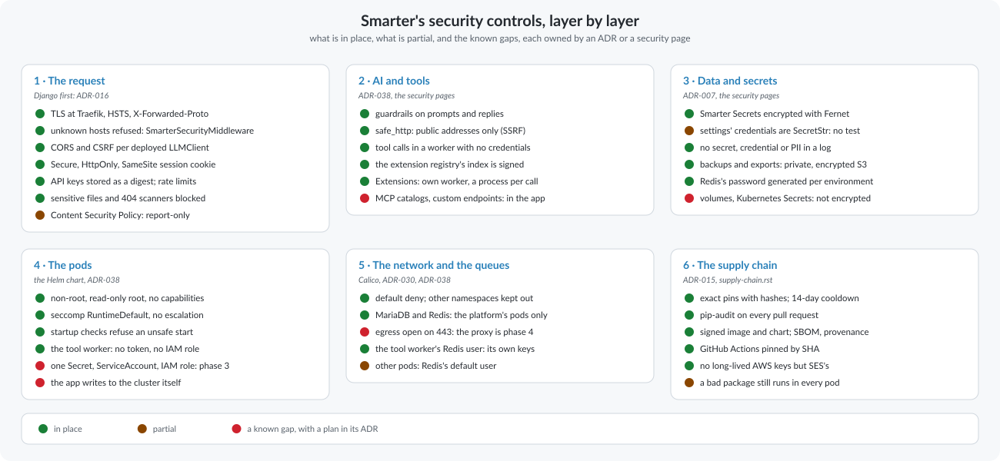

ADR-016: Security
=================

Status
------
Accepted. Rules 1 and 2 are the original decision. Rules 3 to 9 record what later work decided, each in
the ADR or page that owns it, and the inventory below says where the code stands as of 0.48.8.

Context
-------
Security is a critical concern for any web platform. Django provides robust, well-maintained security
features out of the box. Custom security implementations can introduce risk and maintenance overhead if
not handled carefully.

That covers the request. An AI platform has more to protect than its requests. It calls hosts that a
manifest author or the LLM chooses, runs third-party code (Extensions, and every dependency), holds the
credentials of its users' LLM providers, databases and APIs, and runs in a cluster where its pods hold a
cloud identity. The repository is public, so its code, its Helm chart and its defaults are open to anyone.
Most of the platform's security work since this ADR was written is in those areas, and was decided in
later ADRs and in the security pages
(:doc:`../smarter-platform/system-administration/security/application`,
:doc:`../smarter-platform/system-administration/security/infrastructure`,
:doc:`../smarter-platform/system-administration/security/supply-chain`). This ADR lists them in one place.

Decision
--------
1. **Defer to Django.** Use Django's security features: sessions, CSRF, clickjacking protection, password
   hashing and validators, the Content Security Policy (``django.middleware.csp``), and the ORM. Where they
   aren't enough, subclass or replace Django's own middleware, and use the replacement consistently: never
   Django's in one place and Smarter's in another. Smarter's middleware lives in
   ``smarter.lib.django.middleware`` (CORS, CSRF, sensitive files, excessive 404s, JSON errors), unless it
   belongs to one app's concept: the host check, ``SmarterSecurityMiddleware``, is the llmclient app's
   (``smarter.apps.llmclient.middleware.security``), because it knows deployed LLMClients' domains, and
   API key authentication is ``smarter.lib.drf.middleware``'s.
2. **A change to security updates every reference to it**, in the code's comments, the docs and the
   security pages.
3. **Outbound requests to hosts that someone else chooses go through one client**, ``safe_http``: public
   addresses only, every redirect checked, bounded size and time. It is never cached, because it resolves
   DNS on every request (:doc:`ADR-018 <018-caching>`).
4. **Untrusted code runs where there is nothing to steal.** Tool calls, Extensions included, run in the tool
   worker, which holds no credential of the platform's (:doc:`ADR-038 <038-tool-isolation-and-egress>`).
5. **Each workload holds only the credentials its code uses**, and reaches only the hosts it needs
   (ADR-038, phases 3 and 4). The pods run as non-root, on a read-only root filesystem, with every
   capability dropped, seccomp's ``RuntimeDefault`` and no privilege escalation; a pod that doesn't call the
   Kubernetes api gets no token.
6. **Secrets are typed, encrypted and never logged.** A credential in the settings is a ``SecretStr``
   (:doc:`ADR-007 <007-settings>`); a credential that a resource uses is a Smarter Secret, encrypted with
   Fernet; nothing writes a secret, credential or PII to a log, because the web console shows the log to
   users in DEBUG mode (:doc:`../smarter-platform/system-administration/security/application`, "Audit
   Logging and Logs"); and nothing in this public repository is a real
   credential, including a default.
7. **Internal messages are a trust boundary.** A Celery message can make the workers that hold credentials
   act, so a message is authenticated, and a worker runs only its own queue's tasks
   (:doc:`ADR-030 <030-task-queues>`, rules 5 to 9).
8. **Dependencies are pinned, hashed, delayed and audited**, and releases are signed
   (:doc:`ADR-015 <015-dependency-management>`, :doc:`../smarter-platform/system-administration/security/supply-chain`).
9. **Unsafe configuration fails at startup, not at use.** A process refuses to start without its secret
   key, and the tool worker checks its own isolation (``smarter.apps.infrastructure.startup``). Tests never
   reach real infrastructure: they fake every Kubernetes, DNS and AWS call.

The Content Security Policy is one of Django's core features: ``django.middleware.csp.ContentSecurityPolicyMiddleware``, configured by ``SECURE_CSP_REPORT_ONLY`` in ``smarter.settings.base``. Browsers block nothing until the policy moves to ``SECURE_CSP``. They post what it would block to its ``report-uri``, ``/csp-report/`` on the platform's host (``smarter.lib.django.csp``), which logs each distinct violation once an hour at WARNING, naming the page by its url's name and the blocked resource by its origin, so that a token or signed url in a report never reaches the log. Inline scripts carry the request's nonce: ``nonce="{{ csp_nonce }}"`` in a Django template, and ``with_csp_nonce()`` on the web console's page, which isn't a template. No page uses an inline event handler (``onload=``), which a nonce can't allow.

Inventory
---------
Read from the code, the Helm chart and the security pages as of 0.48.8.

         host validation, CORS and CSRF, cookie flags, API key digests, rate limits and scanner blocking are in
         place; the Content Security Policy is report-only. AI and tools: guardrails, safe_http, the tool worker
         and the signed registry are in place; an Extension staying loaded in its worker process, and MCP catalogs
         and custom endpoints reached from the app, are gaps. Data and secrets: Fernet, no secrets in logs and
         encrypted backups are in place; SecretStr settings have no test; Redis's password is now generated; unencrypted
         volumes and Kubernetes Secrets are gaps. The pods: hardened containers, startup checks and the tool
         worker are in place; the shared Secret, ServiceAccount and IAM role, and the app's own cluster writes,
         are gaps. The network and the queues: Calico's default deny is in place; open egress on 443, any Redis
         client queueing any task, and no Redis ACL are gaps. The supply chain is in place, but a bad package
         still runs in every pod.

What holds:

- **Rule 1.** Django's ``SecurityMiddleware`` and ``CsrfViewMiddleware`` are replaced by subclasses, used
  everywhere, which is why ``SILENCED_SYSTEM_CHECKS`` silences ``security.W001`` and ``security.W003``.
  ``security.W004`` and ``security.W008`` (HSTS, the HTTPS redirect) are silenced because Traefik does both.
  CORS replaced django-cors-headers' middleware with Smarter's, also everywhere.
- **Rules 3, 4, 8 and 9**, as their ADRs and pages describe, with the gaps that ADR-038 lists.
- **Rule 6.** 71 settings are ``SecretStr``; the only credential-like setting that is a ``str`` is the
  extension registry's public key, which is not a secret.

What doesn't, and where each gap's plan is:

- **The Content Security Policy is report-only.** It is enforced once its reports are clean.
- **Redis has no ACL** (ADR-030, rule 8, #1065). With Redis's url, any pod can read every session in
  Redis. Its password was public until ADR-030's rule 5: ``base_aws`` used
  ``platform_shared_resource_identifier``, ``smarter`` by default, and the chart and the deploy action set the
  same, which broke rule 6 twice. It is now generated by smarter-infrastructure for each environment.
- **Any process that reaches Redis can make the infrastructure worker act** (ADR-030, rules 6 and 7),
  the tool worker included, which undoes part of rule 4.
- **An Extension stays imported in its tool worker process** after its call, and sees the later calls that
  process runs, with their credentials (ADR-030 and ADR-038).
- **Every pod but the tool worker holds every credential**, and egress on 443 is open (ADR-038, phases 3
  and 4). The app writes to the cluster and EKS itself, which phase 3 must move first.
- **Encryption at rest** of MariaDB's and Redis's volumes and of Kubernetes Secrets is off by default
  (:doc:`../smarter-platform/system-administration/security/application`).
- **Rule 6 isn't tested.** Nothing fails when a new credential setting is a ``str``.

Alternatives Considered
-----------------------
- Implementing custom security features throughout the codebase.
- Relying solely on third-party security packages.
- **Keeping this ADR to the request**, and leaving the platform's security to the ADRs that decided each
  part. Each of those stays the owner of its part, but a reader needs one page that says what the rules are
  and where the gaps are.

Consequences
------------
- **Positive:**

  - Leverages Django's proven security features.
  - Centralizes custom security logic for easier maintenance and review.
  - Reduces risk of inconsistent or incomplete security implementations.
  - One page lists the platform's security rules, and the gaps that remain, with the ADR that owns each.

- **Negative:**

  - Requires contributors to be familiar with Django's security model and project-specific middleware.
  - May require additional effort to update references when customizing security features.
  - The inventory and its diagram go stale unless each change that closes a gap updates them.

Related ADRs
------------
- :doc:`ADR-000: Introduction <000-intro>`
- :doc:`ADR-007: Settings <007-settings>`
- :doc:`ADR-011: Logging <011-logging>`
- :doc:`ADR-015: Dependency Management <015-dependency-management>`
- :doc:`ADR-018: Caching <018-caching>`
- :doc:`ADR-030: Operational and Infrastructure Task Queues <030-task-queues>`
- :doc:`ADR-038: Tool Isolation and Egress Control <038-tool-isolation-and-egress>`
