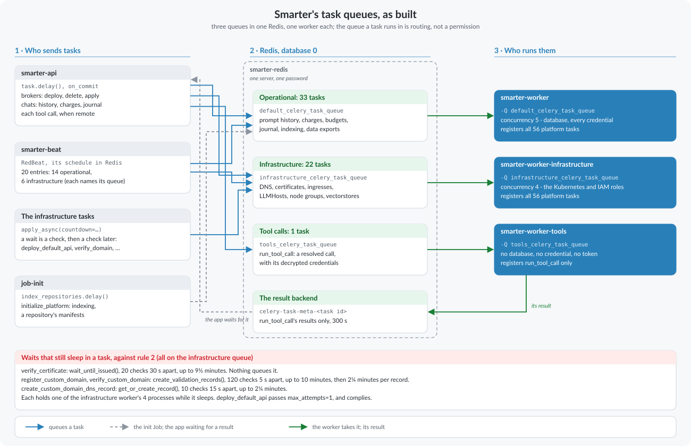
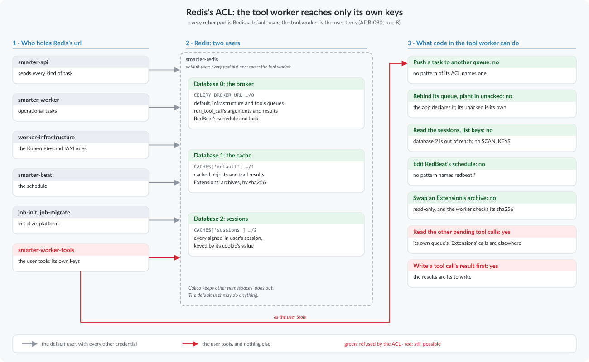

ADR-030: Operational and Infrastructure Task Queues
===================================================

Status
------
Accepted. Rules 1 and 3 hold in the code as of 0.48.8, and rule 4 since ADR-038's phase 2. Rule 2 has four
exceptions, listed in the inventory below. Of the security rules, 5 to 9, rules 5 and 8 are implemented,
for the tool worker: each takes effect when smarter-infrastructure has created its Secret and the chart is
deployed. Rules 6, 7 and 9 are proposed.

Context
-------
Smarter's Celery tasks are of two kinds:

- **Operational** tasks record what happens on the platform: a prompt's history, tool calls and
  plugin usage, charges, budgets, and the aggregation of these records. They are quick, there are
  many of them, and users depend on them: a conversation whose history is not recorded loses its
  context, and a charge that is not recorded escapes its budget.
- **Infrastructure** tasks deploy, verify and destroy cloud, Kubernetes and DNS resources: an
  LLMClient's DNS record, ingress and TLS certificate, a custom domain, an LLMHost's node group, a
  vectorstore's database. A certificate takes minutes to be issued, and a DNS record or a domain's
  name servers take up to a day to propagate.

Both kinds shared one queue and one pool of workers, and the infrastructure tasks waited by
sleeping: ``deploy_default_api`` slept 10 minutes and then polled its certificate for 30 more, and
``verify_domain`` and ``verify_custom_domain`` slept between checks for up to 4 and 24 hours. Deploying
the built-in LLMClients occupied every worker for half an hour, until Celery's task time limit killed
them, while the operational tasks waited behind them. Conversations lost their history, and failed
on their next prompt.

:doc:`ADR-038 <038-tool-isolation-and-egress>` later added a third kind: **tool calls**, which reach
hosts that a manifest author or the LLM chooses, and run in a worker that holds no credentials. That
made the queues a security boundary, which this ADR did not consider when it was written. Every
pod that holds Redis's url can put any task on any queue, and the workers on the other side hold the
platform's most powerful credentials. See `Security`_.

Decision
--------
1. **Separate queues and workers.** Operational tasks run in
   ``smarter_settings.app_llmclient_tasks_celery_task_queue`` (``default_celery_task_queue``), served by
   the ``smarter-worker``. Infrastructure tasks run in
   ``smarter_settings.app_infrastructure_tasks_celery_task_queue`` (``infrastructure_celery_task_queue``),
   served by its own ``smarter-worker-infrastructure``. A deployment can never block an operational task.
2. **Never wait in a task.** A task that waits for something outside Smarter checks once, and if it
   is not ready, schedules itself to check again later, with ``apply_async(countdown=...)``, passing the
   number of attempts made. It does not ``time.sleep()``, so it holds a worker only while it works.
   This includes the sleeps inside the services that a task calls, such as
   ``infrastructure.certificates.wait_until_issued()``: a task calls them with one attempt.
3. **Each task declares its queue** in its ``@app.task(queue=...)``, and each Celery Beat entry names
   the same queue in its ``options``, because Beat sends a task by name, without importing it. A queue
   that no worker consumes is never processed.
4. **Tool calls have their own queue**, ``smarter_settings.app_tools_tasks_celery_task_queue``
   (``tools_celery_task_queue``), served by ``smarter-worker-tools`` (ADR-038). It is the only queue
   whose sender waits for the result: the app's request waits, never a task. Its worker registers
   ``run_tool_call`` alone, so it rejects any other task.

Inventory
---------
Read from the code as of 0.48.8: every ``@app.task``, the Beat schedule (``smarter.workers.celerybeat``),
the Celery settings (``settings/base.py``, ``smarter.lib.celery_conf``), and the workers' commands in the
Helm chart and ``docker-compose.yml``.

         Redis's database 0: 33 operational tasks, 22 infrastructure tasks and one tool call task, run_tool_call,
         whose results the app waits for. smarter-worker and smarter-worker-infrastructure each register all 56
         tasks; smarter-worker-tools registers only run_tool_call. Four infrastructure tasks still wait by
         sleeping.

**The queues.** 56 tasks: 33 operational, 22 infrastructure and one tool call. Every one declares its
queue, and each of Beat's 20 entries (14 operational, 6 infrastructure) names the queue its task
declares. Each queue has exactly one worker that consumes it (``-Q``). Rules 1, 3 and 4 hold.

**Waits that still sleep**, against rule 2. Each holds one of the infrastructure worker's four
processes while it sleeps, so four of them at once stop every deployment, and the 30-minute task time
limit is still what bounds them:

- ``verify_certificate`` calls ``certificates.wait_until_issued()``: 20 checks 30 seconds apart, up to
  9½ minutes. Nothing queues the task. It can be deleted.
- ``register_custom_domain`` and ``verify_custom_domain`` call ``certificates.create_validation_records()``,
  which waits for the certificate's validation records with ``wait_for_validation_records()``: 120 checks
  5 seconds apart, up to 10 minutes. Then, for each record, ``dns.get_or_create_record()`` waits for it to
  appear in its zone: 10 checks 15 seconds apart, up to 2¼ minutes.
- ``create_custom_domain_dns_record`` calls ``dns.get_or_create_record()``: up to 2¼ minutes.
- ``deploy_default_api`` passes ``max_attempts=1`` to ``kubernetes.verify_ingress_resources()``, and
  complies. So do ``verify_domain``, ``verify_custom_domain``'s own re-checks, the LLMHost compute's
  reconciliation and the vectorstore's deployment.

The fix is the same for each: the service's wait takes an attempt count, the task passes one, and
checks again with ``apply_async(countdown=...)``.

**The time limit.** ``CELERY_TASK_TIME_LIMIT`` is 30 minutes, and its docstring still gives Route53's
propagation as the reason, which rule 2 removed. It applies to every queue.

**Long operational tasks.** Rule 1 keeps deployments away from the operational queue, but some
operational tasks are slow for reasons of their own: ``index_repositories`` (GitHub and the blog, every
hour), ``check_llm_prices``, ``refresh_mcpclients``, ``load_vectorstore_document``, ``apply_repository``
and ``execute_orchestration_run``. Five of them at once occupy every ``smarter-worker`` process, and prompt
history waits behind them, which is the problem this ADR set out to solve. Nothing has shown it yet.
If it happens, the fix is a third queue for batch work, by the same rules.

Security
--------
Neither this ADR nor :doc:`ADR-016 <016-security>` said anything about the queues' security when they
were written. Since ADR-038 and the hardening of the pods, the queues are the easiest way from the
least privileged pod to the most privileged one.

         which holds no other credential, is the user tools. Redis's database 0 holds the queues, the tool calls'
         results and RedBeat's schedule, database 1 the cache and database 2 the sessions. As the user tools, code
         in the tool worker is refused pushing to another queue, rebinding its queue, planting a message among
         other workers' unacknowledged ones, reading the sessions or listing keys, editing RedBeat's schedule and
         replacing an Extension's archive. It can still read the other tool calls waiting on its own queue, and
         write a tool call's result first.

What the code does today:

- **Redis's password was public.** In 0.48.8, ``smarter.settings.base_aws`` built the broker's and the
  cache's url with ``smarter_settings.platform_shared_resource_identifier`` as the password, a naming prefix
  that is ``smarter`` by default, and the chart's ``redis.auth.password`` and the deploy action's
  ``REDIS_URL`` were ``smarter`` too, all in this public repository. Rule 5 replaces it with a password that
  smarter-infrastructure generates for each environment. Redis has no access control list, so its one
  password still allows every command on every database, to every pod that holds it. Calico's network
  policies, which admit only the namespace's application pods, are what keeps anyone else out.
- **Every pod holds the url**, the tool worker included: it needs the broker and the cache. ADR-038 says
  that code there "can still reach the cache, the sessions and the other workers' queues". What that
  allows, with the url alone:

  - **Push a task to the infrastructure queue.** ``smarter-worker-infrastructure`` runs whatever task a
    message names, with the Kubernetes Role and the IAM role. Its tasks take ids, and trust them:
    ``delete_default_api``, ``undeploy_default_api``, ``destroy_llmhost``, ``deploy_vectorstore``. The
    operational queue's worker holds the database and every credential, and would run any of the 56
    tasks, as would the infrastructure worker: only the tool worker restricts its registry.
  - **Read the other pending tool calls.** Each message on the tools queue holds a call's decrypted
    credentials until a worker takes it. ADR-038 says that code in the tool worker "finds nothing to
    steal except the one call's credentials", but a ``LRANGE`` of the queue shows every call that is
    waiting. An Extension also stays imported in its worker process (``extension/loader.py`` keeps it in
    ``sys.modules``), so code that patches ``safe_http`` sees every later call that process runs.
  - **Write a tool call's result first.** The app reads ``celery-task-meta-<task id>``. A result written
    there before the real one is what the app hands the LLM.
  - **Read the sessions**, in database 2. Each key's name holds a session's key, which is a valid
    ``sessionid`` cookie: a sign-in as any signed-in user, staff included.
  - **Add an entry to RedBeat's schedule**, which is in Redis: a task that recurs, past every restart.

- **Messages are JSON**, Celery's default; no setting accepts pickle. Infrastructure tasks take ids, not
  data. Operational messages carry users' content: ``create_prompt_history`` and
  ``create_prompt_tool_call_history`` carry prompts, responses and tool arguments,
  ``create_llmclient_request`` a request's body, and ``create_journal_entry`` an api response. They sit in
  Redis, whose volume is persistent, until a worker takes them.
- **Logs.** In the tool worker, ``HideTaskDataFilter`` keeps every task's arguments and result out of
  Celery's log. The other workers log Celery's default records, which don't include arguments.

The security rules, proposed:

5. **Redis's password is a credential.** One per environment, generated by smarter-infrastructure, held
   in a Kubernetes Secret, and read by a ``SecretStr`` setting (:doc:`ADR-007 <007-settings>`). Never a
   default in ``values.yaml`` or the deploy action, and never derived from a setting that isn't secret.
   Changing it means restarting every pod and Redis together.

   Implemented: smarter-infrastructure generates it into the Kubernetes Secret ``smarter-redis-password``,
   the Redis subchart reads it from there (``redis.auth.existingSecret``), and so do the platform's pods,
   as ``SMARTER_SUBSYSTEM_REDIS_PASSWORD`` (``subsystem_redis_password``). ``base_aws`` builds every Redis
   url from it, and refuses to start without it (``require_redis_password()``).
6. **Each worker registers only its own queue's tasks**, as the tool worker does. ``keep_only_tool_worker_tasks()``
   becomes a map from each worker to its tasks, so a message for an infrastructure task that lands on the
   operational queue is rejected, not run. It is cheap, and it narrows what a forged message can reach, but
   doesn't stop one sent to the right queue.
7. **Messages to the workers that hold credentials are signed.** Celery's message signing
   (``app.setup_security()``, the ``auth`` serializer) with a key that every sender holds (the app, beat,
   the two workers that hold credentials, which re-queue their own checks, and the Jobs) and the tool
   worker doesn't. ``smarter-worker`` and ``smarter-worker-infrastructure`` accept only signed messages,
   so a message from anything else that reaches Redis is refused. This closes the way from the tool worker
   to the Kubernetes Role.
8. **One Redis ACL user per workload.** The tool worker's user may read and write only its own queue's
   keys, kombu's, and its results, and read Extensions' archives; not the other queues, RedBeat or
   database 2. Redis's ACLs restrict keys by pattern, not by database, so the cache's keys need a prefix
   the patterns can name, and kombu's exact keys need checking first. This closes the sessions, the
   schedule and the other queues.

   Implemented for the tool worker, the one workload that runs code no one reviewed: the user ``tools``,
   whose password smarter-infrastructure generates in the Secret ``smarter-redis-users``, with the rules in
   the Helm chart's ``redis.master.preExecCmds``. Redis's start script copies its ``master.conf`` to a
   writable directory, and that command appends the user to the copy, with the password read from the
   Secret, which is mounted whole beside Redis's other volumes. The first attempt used the Redis subchart's
   own ``auth.acl``, which mounts its ACL file as a single file (``subPath``) inside the directory where its
   ConfigMap is mounted. runc couldn't create that mount on the cluster's nodes, Redis never started, and
   prod was without Redis for about 12 minutes on 2026-11-27, until the release was rolled back. Neither
   docker-compose nor ``helm template`` creates that mount, so ``make redis-chart-check``
   (``scripts/check_redis_chart.py``) now checks the chart's Redis before a change ships: it fails when a
   volume is mounted inside another volume's mount, and starts prod's Redis image with the chart's
   rendered start script and configuration, as its pod does, to check its users.
   Checking kombu's keys found two more ways out, both closed:

   - Every worker shares kombu's ``unacked`` hash, which holds every queue's messages in flight, and a
     worker that starts restores them to their queues. A tool worker that could write it could plant a
     message that another worker restores to the infrastructure queue. The tool worker keeps its own under
     its queue's name (``CELERY_BROKER_TRANSPORT_OPTIONS``).
   - A worker that declares its queue writes kombu's routing set, ``_kombu.binding.<queue>``, which the app
     reads to route each task. A tool worker that could write it could route tool calls, with their
     credentials, to the infrastructure queue. Its queue is ``no_declare``, and the app declares it.

   The user may also read and write its own ``@cache_results`` keys, ``tools_cache:*``, where e.g. the
   robots.txt rules that a page fetch checks are cached (cache-results' ``CACHE_RESULTS_CACHE``, which the
   Helm chart sets for the two workers only), but none of the platform's cache, append to the console's
   log streams, and publish to ``logs:*`` and the results' channels, but not list keys or channels, nor
   subscribe. What it can still do is read the other tool calls waiting on its own queue, and write a
   result before the worker that ran the call does, both within the tool worker's own trust domain.
   Extensions' calls run in a worker of their own (#1077), the Extension worker, each in a process of its
   own, as the user ``extensions``, which reaches only the Extensions queue, the results, Extensions'
   archives and its own ``@cache_results`` keys, ``extensions_cache:*``: an Extension's code can't read the
   tools queue, nor the tool worker's cache. Each worker's startup check confirms each
   refusal, the other worker's queue among them. docker-compose's Redis
   defines the same user, so the tests check the chart's rules for real.
9. **What a message carries.** Infrastructure tasks take ids, never data. Only ``run_tool_call`` carries a
   credential (ADR-038). Users' content in operational messages is accepted, as it is in the database, and
   Redis's volume is encrypted at rest, which MariaDB's isn't by default either (see
   :doc:`../smarter-platform/system-administration/security/application`). Messages are JSON, never pickle.

The order follows who could use each path. A malicious dependency runs in every pod, including those that
already hold every credential, so Redis gives it nothing new: ADR-038's phases 3 and 4 are what limit it.
The queues matter for code that runs only in the tool worker, an Extension above all. For that code, rule 5
and then rule 8 close every path at once: an ACL user is useless while the default user's password is
public, and with a real password, the tool worker's own user can't push to another queue, read the sessions
or edit the schedule. Rule 6 is cheap, and narrows what any forged message reaches. Rule 7 then protects
against Redis clients that already hold credentials, which makes it defense in depth, and it comes after the
isolation of Extension calls, which no ACL can give, because the tool worker must read its own queue. Until
then, Calico's network policies, the hardened pods, and ADR-038's
tool worker, which keeps Extensions out of the pods that hold credentials, are the protection. The tool
worker's Extensions and their persistence in its processes are ADR-038's: one option is a queue of their
own with ``--max-tasks-per-child=1``.

Alternatives Considered
-----------------------
- **More workers in one queue.** It postpones the problem: enough deployments still occupy every worker.
- **Celery task priorities.** They reorder waiting tasks, but cannot free a worker that a task holds.
- **Separate queues only.** Infrastructure tasks would still hold their own workers while they sleep,
  and run into Celery's task time limit, so a slow DNS propagation would fail a deployment.
- **A separate Redis per worker**, for security. A task's sender and its worker must share a broker, so
  the app would still hold every Redis's url. Signed messages and ACLs do the same with one Redis.
- **TLS to Redis.** It protects the traffic on the cluster's network, which Calico already limits. It
  doesn't tell one client from another.

Consequences
------------
- **Positive:**

  - Operational tasks run promptly, however many deployments are in progress.
  - A deployment that waits hours for DNS holds no worker, and is not killed by the task time limit.
  - The kinds of task can be scaled, monitored and restarted independently.
  - Tool calls run where a compromise finds no credentials of the platform's.

- **Negative:**

  - Two more worker Deployments (``templates/deployment-worker-infrastructure.yaml``,
    ``templates/deployment-worker-tools.yaml``) and docker-compose services.
  - A new task must be assigned to the right queue, and a task that waits must be written as a sequence
    of checks rather than a loop.
  - Until rules 5 to 8 are in place, the queues let code in any pod that reaches Redis act with the
    infrastructure worker's credentials.

Related ADRs
------------
- :doc:`ADR-007: Settings <007-settings>`
- :doc:`ADR-009: Async Tasks <009-async-tasks>`
- :doc:`ADR-016: Security <016-security>`
- :doc:`ADR-038: Tool Isolation and Egress Control <038-tool-isolation-and-egress>`
