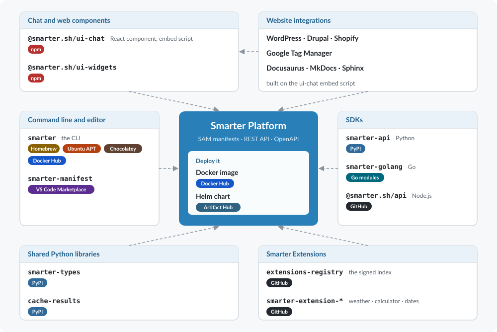

Smarter Development Framework
=============================

The Smarter Development Framework is an opinionated, cloud-native application
framework for building, deploying, and managing AI-powered applications at scale.
Developers declare AI resources, services, configurations, and dependencies in
:doc:`Smarter Manifests <smarter-framework/smarter-manifests>`, a standardized YAML
specification, and the platform does the rest: deployment, governance, cost
management, versioning, and operations.

Around the platform is an ecosystem of open-source packages, each published to the
registry its users already know: PyPI, npm, Homebrew, APT, Chocolatey, the VS Code
Marketplace, Docker Hub, Artifact Hub, and Go modules. Every one of them is a client
of the same :doc:`Smarter API <smarter-framework/smarter-api>` and its
:doc:`OpenAPI contract <smarter-framework/smarter-openapi>`, or a building block that
the platform and those clients share.

         VS Code extension, the Python, Go and Node.js SDKs, the shared Python libraries
         smarter-types and cache-results, the npm chat and widget components, the website
         integrations, Smarter Extensions, and the platform's Docker image and Helm chart.
   :width: 100%
   :class: img-bottom-margin

The Smarter Ecosystem
---------------------

All of these packages are open source, and their source is in the
`smarter-sh <https://github.com/smarter-sh>`__ organization on GitHub.

Command Line and Editor
~~~~~~~~~~~~~~~~~~~~~~~

The :doc:`Smarter CLI <smarter-framework/smarter-cli>`, ``smarter``, works like ``kubectl``: it
applies, describes, deploys and deletes resources from a terminal or a shell script.

.. code-block:: console

   # macOS and Linux, with Homebrew
   brew tap smarter-sh/tap https://github.com/smarter-sh/homebrew-tap
   brew trust smarter-sh/tap
   brew install smarter

   # Ubuntu
   sudo add-apt-repository ppa:lpm0073/smarter-cli
   sudo apt-get update
   sudo apt-get install smarter-cli

   # Windows
   choco install smarter

It is also a Docker image, `mcdaniel0073/smarter-cli
<https://hub.docker.com/r/mcdaniel0073/smarter-cli>`__, and a binary for every platform on its
`releases page <https://github.com/smarter-sh/smarter-cli/releases>`__.

.. list-table::
   :header-rows: 1
   :widths: 30 25 45

   * - Package
     - Published on
     - What it is
   * - ``smarter``
     - Homebrew, `Ubuntu APT <https://launchpad.net/~lpm0073/+archive/ubuntu/smarter-cli>`__,
       `Chocolatey <https://community.chocolatey.org/packages/smarter>`__,
       `Docker Hub <https://hub.docker.com/r/mcdaniel0073/smarter-cli>`__
     - The :doc:`Smarter CLI <smarter-framework/smarter-cli>`.
   * - Smarter Manifest
     - `VS Code Marketplace <https://marketplace.visualstudio.com/items?itemName=Querium.smarter-manifest>`__
     - The :doc:`VS Code extension <smarter-framework/vs-code-extension>`: validation and completion
       of manifests as you type, and the CLI's validate, apply and deploy commands.

SDKs
~~~~

Libraries that give your own software typed, complete access to a Smarter platform. They have the
same resources, verbs and errors in every language.

.. list-table::
   :header-rows: 1
   :widths: 30 25 45

   * - Package
     - Published on
     - What it is
   * - ``smarter-api``
     - `PyPI <https://pypi.org/project/smarter-api/>`__
     - The :doc:`Python SDK <smarter-framework/smarter-python>`, ``pip install smarter-api``, and the
       reference implementation of every Smarter SDK. Its own documentation is at
       `docs.smarter-python.smarter.sh <https://docs.smarter-python.smarter.sh/>`__.
   * - ``smarter-golang``
     - `Go modules <https://pkg.go.dev/github.com/smarter-sh/smarter-golang>`__
     - The :doc:`Go SDK <smarter-framework/smarter-golang>`,
       ``go get github.com/smarter-sh/smarter-golang``.
   * - ``@smarter.sh/api``
     - `GitHub <https://github.com/smarter-sh/smarter-nodejs>`__
     - The :doc:`Node.js SDK <smarter-framework/smarter-nodejs>`, for JavaScript and TypeScript.

Shared Python Libraries
~~~~~~~~~~~~~~~~~~~~~~~

Plain Python packages that the platform is built on, small enough to use on their own.

.. list-table::
   :header-rows: 1
   :widths: 30 25 45

   * - Package
     - Published on
     - What it is
   * - ``smarter-types``
     - `PyPI <https://pypi.org/project/smarter-types/>`__
     - :doc:`The definitions that the platform and the Python SDK share
       <smarter-framework/developer-reference/smarter-types>`: every manifest kind, the order in
       which they are applied, and the Smarter Journal's enumerations. Documented at
       `docs.smarter-types.smarter.sh <https://docs.smarter-types.smarter.sh/>`__.
   * - ``cache-results``
     - `PyPI <https://pypi.org/project/cache-results/>`__
     - A Django decorator that :doc:`caches a function's results by its arguments
       <smarter-framework/developer-reference/lib/caching>`, with safe keys and ``async`` support.
       Documented at `docs.cache-results.smarter.sh <https://docs.cache-results.smarter.sh/>`__.

Chat and Web Components
~~~~~~~~~~~~~~~~~~~~~~~

.. list-table::
   :header-rows: 1
   :widths: 30 25 45

   * - Package
     - Published on
     - What it is
   * - ``@smarter.sh/ui-chat``
     - `npm <https://www.npmjs.com/package/@smarter.sh/ui-chat>`__
     - :doc:`Smarter Chat <smarter-framework/smarter-chat>`, the chat UI of a deployed LLMClient: a
       React component, ``npm install @smarter.sh/ui-chat``, and an embed script that adds the chat
       to any web page with one ``<script>`` tag.
   * - ``@smarter.sh/ui-widgets``
     - `npm <https://www.npmjs.com/package/@smarter.sh/ui-widgets>`__
     - The :doc:`web console's dashboard widgets <smarter-framework/developer-reference/react-integration>`,
       which `smarter.sh <https://smarter.sh/>`__ also uses.

The :ref:`website integrations <apis-and-sdks-integrations>` for WordPress, Drupal, Shopify, Google
Tag Manager, and Docusaurus, MkDocs and Sphinx documentation sites are built on Smarter Chat's
embed script, and add a deployed LLMClient's chat to a site from a settings screen.

Running the Platform
~~~~~~~~~~~~~~~~~~~~

.. list-table::
   :header-rows: 1
   :widths: 30 25 45

   * - Package
     - Published on
     - What it is
   * - ``mcdaniel0073/smarter``
     - `Docker Hub <https://hub.docker.com/r/mcdaniel0073/smarter>`__
     - The platform's Docker image.
   * - ``smarter`` Helm chart
     - `Artifact Hub <https://artifacthub.io/packages/helm/project-smarter/smarter>`__
     - :doc:`Smarter on Kubernetes <smarter-framework/smarter-on-kubernetes>`,
       ``helm install smarter oci://ghcr.io/smarter-sh/charts/smarter``.

Extending Smarter
~~~~~~~~~~~~~~~~~

Smarter is extended in two ways, with :doc:`Plugins and Extensions <smarter-framework/extensibility>`:
Plugins are YAML manifests that configure Smarter's built-in tool patterns, and
:doc:`Extensions <smarter-framework/smarter-extensions>` are Python packages that platform
administrators install at run time, from the signed index in
`smarter-sh/extensions-registry <https://github.com/smarter-sh/extensions-registry>`__. Ready-made
manifests for every kind are in
`smarter-sh/example-manifests <https://github.com/smarter-sh/example-manifests>`__.

How the Framework Fits Together
-------------------------------

At the center of the framework is declarative resource management. A manifest declares what a
resource should be, and the :doc:`Smarter Broker Model <smarter-framework/smarter-broker-model>`
makes it so. Teams focus on application design and business logic rather than deployment mechanics
and platform integration.

The manifests, the API, its OpenAPI contract, the CLI, the SDKs and the website integrations are
grouped under :doc:`Smarter APIs, SDKs and Integrations <smarter-framework/apis-and-sdks>`, which
also presents the design goals that the APIs and SDKs share.

Smarter is built on proven open-source technologies, including Kubernetes, Docker, Django, React,
TypeScript, and Pydantic, and extends them with standardized APIs, automation, and developer
tooling designed for AI applications.

This section of the documentation is the technical reference for the framework, including its
:doc:`architecture <smarter-framework/architecture>`, specifications, APIs, command-line tools,
SDKs, and supporting technologies.

.. toctree::
   :maxdepth: 1
   :caption: Technical Reference

   smarter-framework/getting-started
   smarter-framework/architecture
   smarter-framework/extensibility
   smarter-framework/smarter-extensions
   smarter-framework/guides
   smarter-framework/apis-and-sdks
   smarter-framework/smarter-broker-model
   smarter-framework/smarter-chat
   smarter-framework/smarter-on-kubernetes
   smarter-framework/developer-reference
   smarter-framework/technologies
