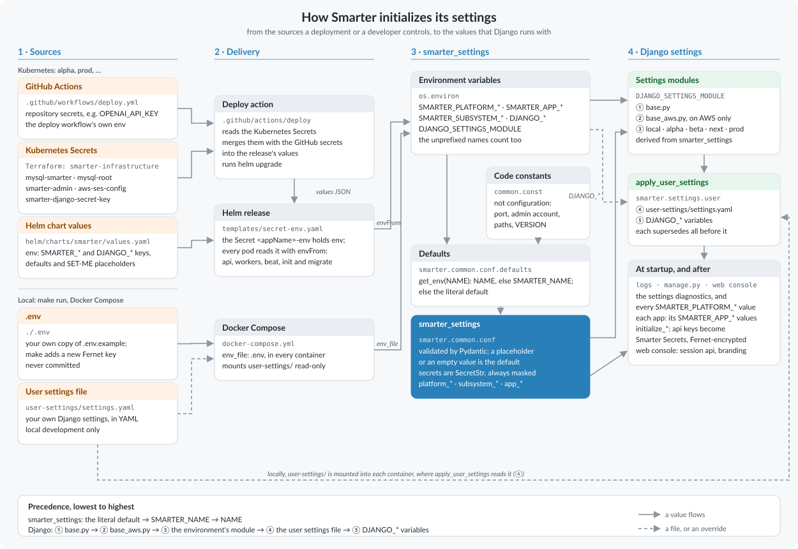

Configuration
===============

Smarter is a Docker-based Django web application and REST API that is highly configurable via environment variables, configuration files, and infrastructure-as-code templates.
This document outlines the various configuration options available for Smarter. The guidelines that follow assume that you are deploying Smarter using
the `recommended approach <installation.html>`_ of AWS EKS with the provided Helm chart and Terraform modules.

How the settings are initialized
--------------------------------

Each setting value originates from one of a few places: in Kubernetes, the GitHub Actions secrets, the Kubernetes
Secrets that `smarter-infrastructure <https://github.com/smarter-sh/smarter-infrastructure>`__ creates, and
the Helm chart's values. Locally these originate from ``.env`` and ``overrides/settings.yaml``.
The deploy action and the Helm release, or Docker Compose, turn these into the process's environment
variables. ``smarter_settings`` reads each of its fields from its environment variable, else uses the default
declared on the field, then validates and freezes its final settings. Django's settings modules derive their settings from
``smarter_settings`` where possible. Last, the deployment's overrides overwrite them: the
``overrides/settings.yaml`` file locally, then ``DJANGO_*`` environment variables.

         aws-ses-config and smarter-django-secret-key, the Helm chart's values, .env and
         overrides/settings.yaml) become environment variables through the deploy action and the Helm
         release's env Secret, or Docker Compose. smarter_settings reads each of its fields from its
         variable, else uses the default declared on the field, and validates them. Django's settings modules,
         base.py, base_aws.py and the environment's module, derive from smarter_settings; the overrides
         file and DJANGO_* variables overwrite them. The startup logs, the initialize commands and the web
         console read the result.
   :width: 100%

1. AWS Infrastructure Configuration
-----------------------------------

See `Cloud Infrastructure <../system-management/cloud-infrastructure.html>`__ for details on configuring the necessary AWS resources using Smarter-supported Terraform modules.
The official Smarter Terraform modules favor simplicity, paradoxically making them conducive to customization.
You should be able to fork and modify these modules to suit your specific infrastructure requirements.

2. Django Settings
------------------

In certain cases, Smarter uses a `superseding singleton settings module <https://github.com/smarter-sh/smarter/blob/main/smarter/smarter/common/conf.py>`_ (hereon, smarter_settings) to establish configuration values.
This module leverages Pydantic to implement enhanced validation and type checking for configuration settings. You are **STRONGLY** recommended to avoid
modifying this module directly unless you are fully aware of the implications. Many of Smarter's configuration settings are programmatically derived from environment variables
set in the Docker container or Kubernetes pod. Modifying this logic can lead to unexpected behavior.

.. note::

  The smarter_settings module also leverages Pydantics' `SecretStr <https://docs.pydantic.dev/latest/api/types/#pydantic.types.SecretStr>`_ type
  to securely handle sensitive configuration values such as API keys, tokens, and passwords. This ensures that sensitive information is not inadvertently exposed in logs or error messages.

Usage:

.. code-block:: python

   from smarter.apps.common.conf import settings as smarter_settings

   print(smarter_settings.environment_cdn_domain)
   smarter_settings.openai_api_key.get_secret_value()
   smarter_settings.dump()

In all other cases, Smarter uses standard Django settings located in `smarter/settings/ <https://github.com/smarter-sh/smarter/tree/main/smarter/smarter/settings>`_:
``base.py`` for every environment, ``base_aws.py`` for the environments on AWS, and one module per environment
(``local.py``, ``alpha.py``, ``beta.py``, ``next.py``, ``prod.py``).

Django defines many more settings than Smarter sets. See `Django Settings <https://docs.djangoproject.com/en/6.0/ref/settings/>`_
for every one, and the next section for how a deployment overrides them.

3. Overrides
------------

A deployment can override any Django setting, without changing Smarter's code: a session's lifetime, the administrators'
email addresses, a Content Security Policy, or a setting of a Django package that you add. The override overwrites
Smarter's own value, in every environment.

.. danger::

   **An override is a hammer.** It replaces Smarter's value of that setting outright, in every environment,
   however carefully Smarter's value was built, and Smarter does nothing to stop you or warn you.

   - Many of Smarter's settings are computed, per environment, from other settings and from ``smarter_settings``:
     the database, the caches and their separate Redis databases for sessions and Celery, storage on S3 or disk,
     allowed hosts, CORS and CSRF origins, cookie security, the Content Security Policy. Yours replaces the result,
     and nothing that was derived from the old value is computed again.
   - A list or a dictionary is replaced whole, not merged. A ``LOGGING`` or ``CACHES`` that leaves out one of
     Smarter's entries removes it.
   - Smarter checks only that a value has the right type, not that it is sensible. A wrong value can stop the
     platform, or quietly weaken its security: a cookie sent without HTTPS, a host that should be refused.

   Before you override a setting, read how Smarter sets it in ``smarter/settings/``, prefer a ``SMARTER_*`` setting
   where one exists, change as few settings as you can, and try the change locally before you deploy it. To undo
   one, delete it: Smarter's own value applies again.

.. important::

   **Where your overrides go depends on where Smarter runs.**

   - **Local development** (Docker Compose, ``make run``): ``overrides/settings.yaml``, in the repository's root.
     This is for your own computer only. The file is never built into the Docker image, and no deployed environment
     reads it.
   - **alpha, beta, next, prod, and every other environment on AWS** (Kubernetes): an environment variable
     named ``DJANGO_<SETTING>`` in ``env`` in the Helm chart's values. To change prod, change the Helm values
     that prod's deployment uses, never ``overrides/``.

The file is a YAML map of upper case setting names to values. A variable sets one setting, and a list or a
dictionary is written as JSON:

.. code-block:: yaml

   # overrides/settings.yaml, locally
   SESSION_COOKIE_AGE: 3600
   ADMINS:
     - ops@example.com

.. code-block:: yaml

   # the Helm chart's values, on Kubernetes
   env:
     DJANGO_SESSION_COOKIE_AGE: "3600"
     DJANGO_ADMINS: '["ops@example.com"]'

``DJANGO_*`` variables work locally too, in ``.env``.

Settings supersede each other in this order, from lowest to highest priority:

1. ``smarter/settings/base.py``
2. ``smarter/settings/base_aws.py``, in the environments on AWS
3. the environment's own module, e.g. ``prod.py``
4. the overrides file, ``overrides/settings.yaml``, locally
5. your ``DJANGO_*`` environment variables

Your value replaces Smarter's whole setting: a dictionary such as ``LOGGING`` is not merged with Smarter's. Where a
``SMARTER_*`` setting exists for what you want to change (see the previous section), prefer it, since Smarter
derives other settings from it.

See :doc:`overrides` for the full explanation: the steps for local development and for the Helm
chart, how to write each kind of value, the rules, and how to check what applied.

.. _sam-app-feature-flags:

Turning resource types off
~~~~~~~~~~~~~~~~~~~~~~~~~~

Each family of resources can be turned off with its own environment variable, e.g. so that a course's
students see only the resources that it teaches. Every flag defaults to true.

.. list-table::
   :header-rows: 1

   * - Environment variable
     - Resource kinds
   * - ``SMARTER_APP_CONNECTION_ENABLE``
     - ApiConnection, SqlConnection
   * - ``SMARTER_APP_GUARDRAIL_ENABLE``
     - Guardrail
   * - ``SMARTER_APP_LLMCLIENT_ENABLE``
     - LLMClient, CustomDomain
   * - ``SMARTER_APP_LLMHOST_ENABLE``
     - LLMHost, LLMHostCompute
   * - ``SMARTER_APP_LLMTOOL_ENABLE``
     - Plugin, ApiPlugin, ImageSearchPlugin, SkillPlugin, SqlPlugin, WebsearchPlugin, and Extensions
   * - ``SMARTER_APP_MCPCLIENT_ENABLE``
     - MCPClient
   * - ``SMARTER_APP_ORCHESTRATOR_ENABLE``
     - Orchestrator
   * - ``SMARTER_APP_PROVIDER_ENABLE``
     - Provider
   * - ``SMARTER_APP_PROXY_ENABLE``
     - Proxy
   * - ``SMARTER_APP_SECRET_ENABLE``
     - Secret
   * - ``SMARTER_APP_VECTORSEARCH_ENABLE``
     - Vectorsearch
   * - ``SMARTER_APP_VECTORSTORE_ENABLE``
     - Vectorstore

A resource type that is off is off everywhere:

- its web console pages, its web console api (``/api/web/``) and its REST api (``/api/v1/``) answer 404,
  and the session api reports its flag as false, so the console leaves out its sidebar link;
- the cli api refuses its manifests, e.g. ``smarter apply`` of a Guardrail answers 400, with the
  environment variable that turns it on, and ``smarter validate`` reports a ``disabled_kind`` error;
- ``initialize_platform`` skips its example manifests;
- its app connects none of its signal receivers;
- with ``SMARTER_APP_LLMCLIENT_ENABLE=false``, deployed LLMClients answer 404.

Accounts, users, budgets, API keys and prompts have no flag: the platform doesn't work without them.

Resources that refer to each other need their types on together: an LLMClient's plugins need
``SMARTER_APP_LLMTOOL_ENABLE``, a Proxy's provider ``SMARTER_APP_PROVIDER_ENABLE``. ``manage.py check`` warns
about each such reference to a type that is off (``smarter.W003``), from the models' relations, and
``manage.py check --database default`` about a type that is off and still has rows in the database
(``smarter.W004``), which nothing can read or delete through Smarter until it is on again. See
:mod:`smarter.lib.manifest.sam_apps` and :mod:`smarter.lib.manifest.checks`.

4. Asynchronous Task Queue Configuration
----------------------------------------

Smarter uses Celery as its asynchronous task queue. Celery configuration settings can be found in `smarter/settings/celery.py <https://github.com/smarter-sh/smarter/blob/main/smarter/smarter/settings/celery.py>`_.
Celery relies on a message broker and result backend, both of which can be configured via environment variables. By default, Smarter is configured to use Redis as both the message broker and result backend.
This is known to work well for most use cases. However, you can configure Celery to use other brokers and backends as needed.

**If you are not running at scale then the default Celery configuration should suffice.**

See `Celery configuration <https://github.com/smarter-sh/smarter/blob/alpha/smarter/smarter/workers/celery.py>`_ for more details on how Celery is configured in Smarter.

5. Beat Scheduler Configuration
-------------------------------

Smarter uses Celery Beat to schedule periodic tasks. The schedule is defined in code, in `smarter/workers/celerybeat.py <https://github.com/smarter-sh/smarter/blob/main/smarter/smarter/workers/celerybeat.py>`_,
not in the database, so it can't be edited in the Django admin.
Like asynchronous task queue configuration, the Beat scheduler relies on the same message broker as Celery.
In AWS, Beat keeps its schedule state in Redis with RedBeat (``CELERY_BEAT_SCHEDULER``), so that a restarted Beat pod
picks up where the last one stopped. Locally it uses Celery's default file-based scheduler.

6. Helm Chart Configuration
---------------------------

The Smarter cloud platform is deployed using `Smarter's official Helm chart <https://artifacthub.io/packages/helm/project-smarter/smarter>`_. Configuration options for this Helm chart can be found
in the `values.yaml <https://github.com/smarter-sh/smarter/blob/alpha/helm/charts/smarter/values.yaml>`_ file. Additional
documentation on this Helm chart can be found in the `Helm Chart Documentation <https://artifacthub.io/packages/helm/project-smarter/smarter>`_.

.. warning::

  Kubernetes is a complex topic with a substantial learning curve. The Helm chart, as published is known to work well for most use cases.
  That is, installations that are running in production, at scale, or otherwise mission critical. It is **EXCEEDINGLY UNLIKELY** that you will need to modify the Helm chart configuration to suit your needs.
  Therefore, you are **STRONGLY** recommended to avoid modifying the Helm chart itself, beyond providing the pre-programmed values.yml data,
  unless you know what you are doing, and you are fully aware of the implications.

7. Dockerfile Configuration
---------------------------

The official Docker container image for Smarter (`hub.docker.com/r/mcdaniel0073/smarter <https://hub.docker.com/r/mcdaniel0073/smarter>`_) is
built using the `Dockerfile <https://github.com/smarter-sh/smarter/blob/main/Dockerfile>`_ from the main branch of Smarter's main code
repository, `https://github.com/smarter-sh/smarter <https://github.com/smarter-sh/smarter>`_.

This Docker image favors simplicity over configurability, hence, there are limited configuration options.

8. GitHub Actions Secrets Configuration
---------------------------------------

If you intend to use the provided GitHub Actions workflows for CI/CD, you will need to a.) fork the repository, and b.) configure several GitHub Secrets in your repository.
See `GitHub Actions CI/CD <../developers/ci-cd.html>`_ for details on the required secrets and their configuration.

See `GitHub Secrets Configuration <https://github.com/smarter-sh/smarter/settings/secrets/actions>`_ for the list of currently configured GitHub Secrets in the main Smarter repository.

.. list-table:: **GitHub Actions Secrets Reference**
   :header-rows: 1

   * - Secret Name
     - Description
   * - AWS_ACCESS_KEY_ID
     - AWS access key for CI/CD and deployment automation
   * - AWS_REGION
     - AWS region for resource provisioning
   * - AWS_SECRET_ACCESS_KEY
     - AWS secret access key for CI/CD and deployment automation
   * - FERNET_ENCRYPTION_KEY
     - Key for encrypting/decrypting Pydantic Secrets data in smarter_settings
   * - GEMINI_API_KEY
     - API key for Gemini AI integrations
   * - GOOGLE_AI_STUDIO_KEY
     - API key for Google AI Studio services
   * - GOOGLE_MAPS_API_KEY
     - API key for Google Maps integrations (for getweather() LLM tool)
   * - TAVILY_API_KEY
     - API key for Tavily web search, stored as the Secret tavily_api_key, which WebsearchPlugins such as the sample smarter_project_websearch use. See :doc:`Tavily <../smarter-framework/technologies/tavily>`
   * - BRAVE_SEARCH_API_KEY
     - API key for the Brave Search API, stored as the Secret brave_search_api_key, which ImageSearchPlugins and the Brave WebsearchPlugin samples use. See :doc:`ImageSearchPlugin <../smarter-resources/llmtool/plugin/image-search>`
   * - GOOGLE_SERVICE_ACCOUNT_B64
     - Base64-encoded Google service account credentials
   * - LLAMA_API_KEY
     - API key for Llama AI integrations
   * - OPENAI_API_KEY
     - API key for OpenAI integrations
   * - PAT
     - Personal Access Token for GitHub or other services
   * - PINECONE_API_KEY
     - (optional) API key for Pinecone vector database
   * - SLACK_BOT_TOKEN
     - (optional) A Slack app's bot token, ``xoxb-...``, with the scopes ``chat:write`` and ``files:write``. The init Job and the nightly backup post their outcome and log to Slack with it. See :doc:`Smarter on Kubernetes <../smarter-framework/smarter-on-kubernetes>`
   * - SMARTER_MYSQL_BACKUP_PASSWORD
     - (optional) Password of the read-only MariaDB account, ``smarter_backup``, that the nightly backup dumps the database with. Unset: the backup dumps as root
   * - SMTP_PASSWORD
     - SMTP server password for outgoing email
   * - SMTP_USERNAME
     - SMTP server username for outgoing email
   * - SOCIAL_AUTH_GITHUB_KEY
     - OAuth client ID for GitHub social login
   * - SOCIAL_AUTH_GITHUB_SECRET
     - OAuth client secret for GitHub social login
   * - SOCIAL_AUTH_GOOGLE_OAUTH2_KEY
     - OAuth client ID for Google social login
   * - SOCIAL_AUTH_GOOGLE_OAUTH2_SECRET
     - OAuth client secret for Google social login
   * - SOCIAL_AUTH_LINKEDIN_OAUTH2_KEY
     - OAuth client ID for LinkedIn social login
   * - SOCIAL_AUTH_LINKEDIN_OAUTH2_SECRET
     - OAuth client secret for LinkedIn social login

9. Secrets Management
---------------------

One of Smarter's broader challenges is secure secrets management. Smarter uses many kinds of secrets, including API keys, database credentials, and encryption keys.
These secrets obviously have to be stored somewhere, and securely passed around for purposes of normal CI/CD, deployment, and runtime operation of the application.

Smarter currently relies on four primary mechanisms for secrets management:

- **GitHub Actions Secrets:** For CI/CD workflows, as described above.
- **Kubernetes Secrets:** For storing secrets in the Kubernetes cluster where Smarter is deployed. See `Kubernetes Secrets <https://kubernetes.io/docs/concepts/configuration/secret/>`_.
  These are excluvisively generated by Terraform during infrastructure provisioning, and, with modest effort can be made to rotate on demand.
  Kubernetes Secrets are used primarily for AWS cloud based deployments, using the following GitHub Actions workflow code pattern:

  .. code-block:: yaml

    - name: Install kubectl
      id: kubectl-install
      shell: bash
      run: |-
        sudo snap install kubectl --classic

    # setup kubeconfig using the aws eks helper command, 'update-kubeconfig'
    - name: Configure kubectl
      id: kubectl-configure
      shell: bash
      run: |-
        aws eks --region ${{ inputs.aws-region }} update-kubeconfig --name ${{ env.EKS_CLUSTER_NAME }} --alias ${{ env.EKS_CLUSTER_NAME }}
        echo "kubectl version and diagnostic info:"
        echo "------------------------------------"
        kubectl version
      env:
        EKS_CLUSTER_NAME: apps-hosting-service

    # install jq, which k8s-get-secret will use to parse the Kubernetes secret
    # and set the environment variables
    - name: Install jq
      shell: bash
      run: |
        sudo apt-get update
        sudo apt-get install -y jq

    - name: Configure MariaDB from Kubernetes secret
      id: get-mysql-secret
      uses: ./.github/actions/k8s-get-secret
      with:
        eks-namespace: ${{ env.NAMESPACE }}
        eks-secret-name: mysql-smarter

  See `actions/k8s-get-secret <https://github.com/smarter-sh/smarter/blob/main/.github/actions/k8s-get-secret/action.yml>`_ for more details on this custom GitHub Action.

- **.env Files:** For local development and testing environments. These are used for local Docker Compose deployments
  and local Kubernetes deployments using tools like Minikube or Kind.
  See `example-dot-env <https://github.com/smarter-sh/smarter/blob/main/docs/example-dot-env>`_ file is provided in the repository for reference
  and can be automatically initialized for you by running `make` on the command line from the root of the repository.

  .. danger::

    .env files are intended for local development and testing purposes only. They should **NEVER** be used in production environments.
    Storing sensitive information in plain text files poses significant security risks. Always use secure secrets management mechanisms,
    such as Kubernetes Secrets, in production deployments.

    **These files should never be committed to source control!!!**

- **Pydantic SecretStr:** For securely handling sensitive configuration values within the application code. These
  are used within the Python source code, inside Smarter's smarter_settings module described above
  for handling any data considered sensitive, such as API keys, tokens, and passwords.

*Less is more, and simpler is better, so the fewer secrets management mechanisms you have to deal with, the better.*

10. Logging Configuration
-------------------------

Smarter application logs are highly configurable. By default, Smarter uses Python's built-in logging module to log messages to an application log file that
resides inside the running Kubernetes pod at `/var/log/???????????` (FIX NOTE: where in the heck are these???). This can be changed by modifying the logging configuration in `smarter/settings/base.py (logging config) <https://github.com/smarter-sh/smarter/blob/main/smarter/smarter/settings/base.py#L477>`_.
See `Django Logging Documentation <https://docs.djangoproject.com/en/5.2/topics/logging/>`_ for more details on how logging is configured in Smarter.

Smarter additionally provides more granular control over logging levels for specific application components via waffle switches. These are useful for real-time, in-flight
debugging and trouble shooting without requiring application restarts or code changes.

.. raw:: html

   

11. Database Configuration
-----------------------------

Database configuration settings are ultimately controlled by `smarter/settings/base.py (database config) <https://github.com/smarter-sh/smarter/blob/main/smarter/smarter/settings/base.py#L336>`_
for local development and testing environments, and by Kubernetes Secrets for AWS cloud based deployments, as described above. In both cases, the following orders of precedence are observed:

1. Environment variables set in the Docker container or Kubernetes pod.
   These are consumed and validated by the smarter_settings module, internally encrypted by Pydantic SecretStr where applicable, and passed down to Django settings.
2. Kubernetes Secrets (for AWS cloud deployments) or .env files (for local development and testing). These in point of fact, are environment variables subject to the same treatment
   as #1 above, albeit these take a more colorful route to get there.
3. Default values hardcoded in `smarter/settings/base.py (local database config) <https://github.com/smarter-sh/smarter/blob/main/smarter/smarter/settings/base.py#L336>`_ for local development and testing environments,
   and `settings/base_aws.py <https://github.com/smarter-sh/smarter/blob/main/smarter/smarter/settings/base_aws.py#L37>`_ for AWS cloud based deployments regardless of environment.

Regardless of how the configuration values were ingested, the final database configuration values are accessible via both Django settings and smarter_settings.

  .. code-block:: ini

      SMARTER_SUBSYSTEM_SQL_HOST: mysql.example.com
      SMARTER_SUBSYSTEM_SQL_PORT: "3306"
      SMARTER_SUBSYSTEM_SQL_DATABASE: smarter_platform_prod
      SMARTER_SUBSYSTEM_SQL_PASSWORD: <A SECURE PASSWORD SET IN KUBERNETES SECRET OR .env FILE>
      SMARTER_SUBSYSTEM_SQL_USER: smarter_platform_prod

.. note::

  Pydantic SecretStr and Kubernetes Secrets serve similar purposes in securely handling sensitive configuration values such as database and vendor api credentials.
  However, they operate at different layers of the application stack. Kubernetes Secrets are used for securely storing and managing secrets at the infrastructure level,
  while Pydantic SecretStr is used within the application code itself to ensure that sensitive information is not inadvertently exposed in logs or error messages.

12.   Email/Notification Configuration
---------------------------------------

SMTP Email Services allow your system to send emails using an external SMTP server.
Smarter uses `AWS Simple Email Service <https://aws.amazon.com/ses/>`_ (SES) by default, but you can configure it to use any SMTP server of your choice.

.. tip::

   It is highly recommended to use AWS Simple Email Service (SES) for sending emails as this is known to be both cost effective and reliable.
   It is also recommended to use Smarter's provided Terraform scripts to set up the necessary SES resources as this is a more complex operation than might be expected, and the Terraform scripts will automate all of this for you. See `Cloud Infrastructure <cloud-infrastructure.html>`__ for more information.

To configure SMTP Email Services, follow one of these two steps:

- (Recommended) Use the Smarter `Terraform scripts <cloud-infrastructure.html>`_ to automatically create the necessary SES resources, including verified domains and SMTP credentials. This will also generate a Kubernetes Secret containing the SMTP credentials to be used by Smarter's default GitHub Actions deployment workflow.

- In your Smarter settings for deployment ensure that your .env files includes all six SMTP variables (see below) for your SMTP service of choice.

SMTP settings are ultimately controlled by `smarter/settings/base.py (smtp config) <https://github.com/smarter-sh/smarter/blob/main/smarter/smarter/settings/base.py#L527>`_
for local development and testing environments, and by Kubernetes Secrets for AWS cloud based deployments, as described above. In both cases, the following orders of precedence are observed:

1. Environment variables set in the Docker container or Kubernetes pod.
   These are consumed and validated by the smarter_settings module, internally encrypted by Pydantic SecretStr where applicable, and passed down to Django settings.
2. Kubernetes Secrets (for AWS cloud deployments) or .env files (for local development and testing). These in point of fact, are environment variables subject to the same treatment
   as #1 above, albeit these take a more colorful route to get there.

Regardless of how the configuration values were ingested, the final smtp configuration values are accessible via both Django settings and smarter_settings.

   .. code-block:: ini

      SMTP_HOST: email-smtp.us-east-1.amazonaws.com
      SMTP_PASSWORD: <A CREDENTIAL GENERATED IN AWS SES>
      SMTP_PORT: "587"
      SMTP_USE_SSL: "false"
      SMTP_USE_TLS: "true"
      SMTP_USERNAME: <A USERNAME GENERATED IN AWS SES>

You can test your SMTP configuration by sending a test email from the Django console:

.. code-block:: bash

   python manage.py send_welcome_email --email john.doe@example.com

13.   Static & Media Files Configuration
---------------------------------------------

Media files, the files that users upload, are stored in the environment's Amazon S3 bucket when AWS is
configured, and served from its CloudFront CDN, ``cdn.<platform>``; otherwise they are stored on the
server's file system.

Static files, the web console's scripts, styles and images, are served by the server itself, with
WhiteNoise, which needs no CDN and works on any installation. On AWS, set
``SMARTER_PLATFORM_STATIC_FILES_ON_CDN=true`` to serve them from the CDN instead: each deployment's
``initialize_platform`` uploads them to the bucket, under ``static/``, and the console's pages load
them from ``cdn.<platform>/static/`` once that deployment's upload is done. The pages, the api and the
session stay on the platform's own host. The deployment's AWS user needs ``s3:PutObject``,
``s3:PutObjectAcl``, ``s3:GetObject`` and ``s3:ListBucket`` on the bucket. See
:doc:`/smarter-framework/developer-reference/lib/django/static-storage`.

The storage settings are in `smarter/settings/base.py <https://github.com/smarter-sh/smarter/blob/main/smarter/smarter/settings/base.py>`_.
Avoid changing them unless you have a specific need.

.. warning::

  When deploying Smarter in production environments, it is **CRITICAL** to ensure that static and media files are served securely using HTTPS.
  Failure to do so can lead to security vulnerabilities and data breaches. Always use Amazon CloudFront with SSL/TLS certificates for secure delivery of static and media files.

See `Django Static Files Documentation <https://docs.djangoproject.com/en/5.2/howto/static-files/>`_ for more details on how static and media files are configured in Smarter.

14. Smarter Settings Class Reference
------------------------------------

The Smarter settings system is implemented as an immutable singleton object called `smarter_settings <https://github.com/smarter-sh/smarter/blob/main/smarter/smarter/common/conf.py>`_.
This object contains all validated, derived, and superseding configuration values for the platform.
The ``smarter_settings`` class enforces a consistent set of rules for initializing configuration values from multiple sources,
including environment variables, ``.env`` files, and class-defined defaults. All configuration
values are strongly typed and validated. Where applicable, ``smarter_settings`` values take precedence over Django
settings. You should use ``smarter_settings`` in preference to Django settings wherever possible, as Django settings
are often initialized from values in ``smarter_settings``.

**Notes:**

- ``smarter_settings`` values are immutable after instantiation.
- Every property or attribute in ``smarter_settings`` is guaranteed to have a value.
- Sensitive values are stored as Pydantic ``SecretStr`` types to prevent accidental exposure.
- Configuration values are initialized in the following order of precedence:

  1. Constructor (not recommended; prefer ``.env`` or environment variables)
  2. Environment variables, which include the ``.env`` file's. Each field is read from its name in
     capitals with the ``SMARTER_`` prefix, which is required: ``debug_mode`` from
     ``SMARTER_DEBUG_MODE``. A list is comma-separated, and a boolean ``true`` or ``false``. The
     exceptions keep the names that other tools use: ``AWS_PROFILE``, ``AWS_ACCESS_KEY_ID``,
     ``AWS_SECRET_ACCESS_KEY``, ``AWS_REGION``, ``GITHUB_TOKEN`` and ``DJANGO_SECRET_KEY``.
  3. The default declared on each field. A default that depends on another setting, such as the SMTP
     sender at the root domain, is derived from that setting's value.

- The ``dump`` property returns a dictionary of all configuration values, which is useful for debugging and logging.
- Always access configuration values via the ``smarter_settings`` singleton instance when possible.

.. toctree::
   :hidden:
   :maxdepth: 1

   url-patterns
   overrides
