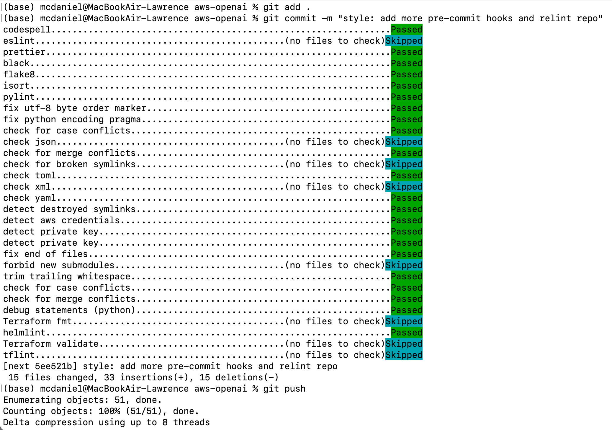
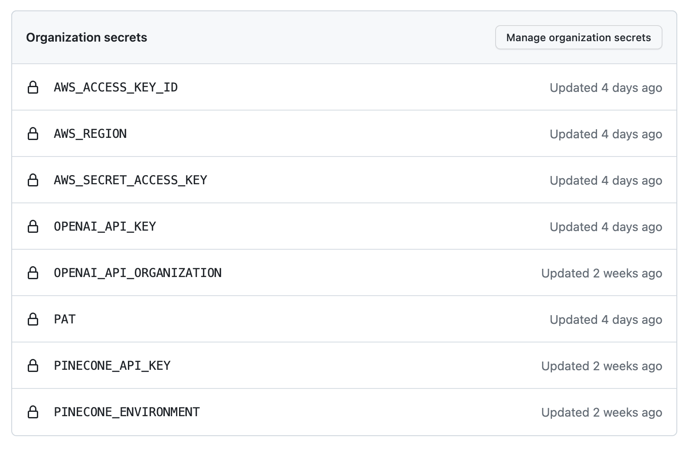
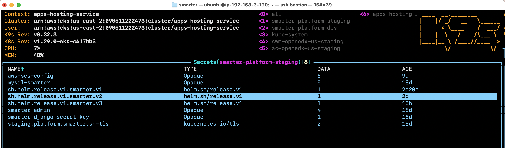
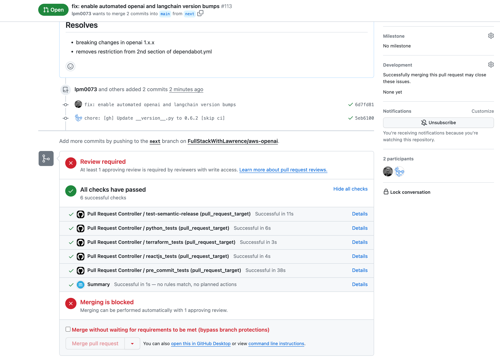

:orphan:

Developer Installation Guide
============================

This guide sets up a development environment for Smarter on your own computer, built from
source code: the Django backend in `smarter-sh/smarter <https://github.com/smarter-sh/smarter>`__,
and, if you work on the user interface, the React web console in
`smarter-sh/smarter-console <https://github.com/smarter-sh/smarter-console>`__. It covers
initializing the environment from scratch, the ``.env`` file, building, running the platform
locally, and running the tests. To run Smarter without changing its code, the
:doc:`Quick Start Guide </smarter-platform/installation/quick-start>` uses the pre-built images on
Docker Hub instead.

This eight-minute developer onboarding video walks through the same steps.

.. raw:: html

   <iframe width="560" height="315" src="https://www.youtube.com/embed/POjSx6mpTq8" title="Smarter developer onboarding: the development environment" frameborder="0" allowfullscreen></iframe>

Prerequisites
-------------

Before attempting to set up this project, make sure that the following are installed on your
computer:

- Docker Desktop or Docker CE 25.x or later, with Docker Compose
- Node.js 24 or later, and npm
- Python 3.14 or later
- git 2.x or later
- make 3.8 or later
- openssl, which ``make`` uses to create the ``.env`` file's encryption key

The repository has a setup script for each operating system, in
`setup/ <https://github.com/smarter-sh/smarter/tree/main/setup>`__, that installs these and the
native libraries that the local Python virtual environment builds against. Read the script and the
README beside it before you run it.

.. list-table::
   :header-rows: 1

   * - Operating system
     - Script
     - Run it with
   * - macOS
     - `setup/macos/setup.sh <https://github.com/smarter-sh/smarter/blob/main/setup/macos/setup.sh>`__
     - ``bash setup/macos/setup.sh``
   * - Debian or Ubuntu
     - `setup/ubuntu/setup.sh <https://github.com/smarter-sh/smarter/blob/main/setup/ubuntu/setup.sh>`__
     - ``bash setup/ubuntu/setup.sh``
   * - Windows
     - `setup/windows/setup.ps1 <https://github.com/smarter-sh/smarter/blob/main/setup/windows/setup.ps1>`__
     - ``powershell -File setup\windows\setup.ps1``, as Administrator

The macOS and Ubuntu folders also have a ``.zshrc.example``, with the paths and compiler and linker
flags that the virtual environment's native packages need. Merge what you need into your own
``~/.zshrc`` rather than replacing it.

Give Docker at least 8 GB of memory and 4 CPUs. The test suite runs several copies of the platform
at once, one per CPU it has room for (see `Running the Tests`_).

If you work on cloud infrastructure, you'll also need these:

- terraform, latest
- terragrunt, latest
- awscli, latest

Initializing the Environment from Scratch
-----------------------------------------

Clone the repository, then initialize it:

.. code-block:: console

   git clone https://github.com/smarter-sh/smarter.git
   cd smarter
   make         # creates .env, with a new encryption key, then lists every make command
   make init    # up to 20 minutes

Any ``make`` command creates the ``.env`` file the first time it runs, if there isn't one (see
`The .env File`_). Add your LLM provider API keys to it before ``make init``, so that the platform
stores them as it initializes.

``make init`` runs these steps, each of which is also a ``make`` command of its own:

.. list-table::
   :header-rows: 1

   * - Step
     - What it does
   * - ``make check-python``, ``make docker-check``
     - Checks that Python 3.14 is installed, and that Docker is running.
   * - ``make python-init``
     - Creates the Python virtual environment, ``venv/``, and installs the development
       requirements, ``smarter/requirements/local.txt``, into it.
   * - ``make console``
     - Downloads the web console release that ``smarter-console-version.txt`` pins, and unpacks
       it into ``smarter/smarter/static/react/`` (see `The Web Console`_).
   * - ``make collectstatic``
     - Collects the static files, the web console's included, into ``smarter/staticfiles/``.
   * - ``make docker-build``
     - Builds the ``smarter`` Docker image.
   * - ``make docker-init``
     - Starts the containers, creates the ``smarter`` database in MariaDB, runs the migrations,
       then runs ``manage.py initialize_platform``, which creates the admin user, the example
       resources, the LLM providers, and the rest of the platform's seed data.
   * - ``make pre-commit-init``
     - Installs the pre-commit hooks (see `Code Style and pre-commit`_).

When it's done, the containers are still running, and the web console is at
http://localhost:9357/. Sign in as:

- **Username:** ``admin``
- **Email:** ``admin@example.com`` (or ``admin@`` your ``SMARTER_PLATFORM_ROOT_DOMAIN``)
- **Password:** ``smarter``

MariaDB is at ``localhost:3306``, as user ``root``, password ``smarter``. These are local
development credentials only.

To start over from nothing, run ``make tear-down`` (it deletes the virtual environment and prunes
Docker's unused images, containers and volumes), delete the ``mariadb-data/`` folder, which holds
the local database, then run ``make init`` again. Keep your ``.env``: its encryption key is what
decrypts the Secrets stored in the database.

The .env File
-------------

The ``.env`` file in the root of the repository holds your local configuration. ``make`` creates it
from `.env.example <https://github.com/smarter-sh/smarter/blob/main/.env.example>`__, which
documents every value, and Docker Compose, the Makefile and Django all read it. Git ignores it:
never commit it.

Required
~~~~~~~~

Only one value is required, and ``make`` sets it for you:

``SMARTER_PLATFORM_FERNET_ENCRYPTION_KEY``
   Encrypts Smarter Secrets, such as API keys, in the database. ``make`` appends a new key when it
   creates ``.env``. To make one yourself:

   .. code-block:: console

      openssl rand -base64 32 | tr '+/' '-_'

   Every process (``smarter-api``, each worker, each ``manage.py`` call) must use the same key. If
   the key changes, every Secret in the database becomes unreadable.

The other values in the *Local development* section of ``.env.example`` are already set for local
work (``SMARTER_ENVIRONMENT=local``, ``SMARTER_DEBUG_MODE=true``, and so on). Leave them as they
are.

Recommended
~~~~~~~~~~~

The platform runs without any other value. A feature whose setting is missing logs an error that
says what to set when you use it. For example, a prompt to an LLM provider that has no key fails
with an error that names the Smarter Secret to set.

The LLM providers' and tools' keys are not ``.env`` variables: every container receives ``.env``,
and a key's only source is its Smarter Secret. Write each key into a file named after its Secret,
in the repository's ``bootstrap-secrets/`` folder, which git ignores and docker-compose mounts,
read-only, into ``smarter-api`` only. To try the example LLMClients, set at least:

``bootstrap-secrets/openai_api_key``
   OpenAI is the default LLM provider, used by most of the example LLMClients.

.. code-block:: console

   mkdir -p bootstrap-secrets
   printf %s 'sk-...' > bootstrap-secrets/openai_api_key

The other providers (``anthropic_api_key``, ``gemini_api_key``, ``mistral_api_key`` and so on),
the web search tools (``tavily_api_key``, ``brave_search_api_key``) and ``GITHUB_TOKEN`` (in
``.env``) are optional. Section 3 of ``.env.example`` lists every file name. If your ``.env`` still
has the keys as variables, such as ``SMARTER_APP_PROVIDER_OPENAI_API_KEY``, ``make
bootstrap-secrets`` writes the files from them; then delete them from ``.env``. ``make init``
creates a Smarter Secret, owned by the Smarter admin, from each file. If you add one later, run
the command that creates it:

.. code-block:: console

   docker exec smarter-api python manage.py initialize_platform

The cloud deployment, email and social sign-in values are for deployed platforms; you don't need
them locally. :doc:`Configuration </smarter-platform/configuration>` explains how these values
become Smarter's settings.

Building the Application
------------------------

The platform runs from one Docker image, ``smarter``, used by every container except MariaDB and
Redis. **The containers don't mount your source code**: each one runs the copy of the code that
was built into the image. After you change the code, rebuild, then restart:

.. code-block:: console

   make build   # a few seconds, once Docker has cached the requirements
   make run

``make build`` copies the host's ``smarter/staticfiles/`` into the image rather than collecting
the static files itself. So when the static files change, which includes installing another build
of the web console, collect them first:

.. code-block:: console

   make console          # the pinned release of the web console
   make collectstatic    # into smarter/staticfiles/
   make build

Without ``make collectstatic``, the web console's pages answer 503. Django caches a missing console
build, so restart ``smarter-api`` after fixing the static files.

``make docker-build-for-react`` is the full build that CI uses: it runs ``collectstatic`` inside
the image instead. ``make help`` lists every other command.

The Web Console
---------------

The web console is a single-page React app. Its source is a repository of its own,
`smarter-sh/smarter-console <https://github.com/smarter-sh/smarter-console>`__, an npm workspace
of the console and the packages it's built from, Smarter Chat included. Django serves the console's
page at every console path, and the console talks to the backend only over HTTP: the web console
api (``/api/web/``), the public api (``/api/v1/``) and the session (``/api/web/session/``). See
:doc:`ADR-035 </adr/035-single-page-app>`.

This repository doesn't build the console. It installs a released build: each smarter-console
release attaches ``smarter-console-<version>.tar.gz``, and ``smarter-console-version.txt`` pins the
version that ``make console`` downloads. To work on the backend alone, that's all you need.

To change the console, clone it next to this repository:

.. code-block:: console

   cd ..
   git clone https://github.com/smarter-sh/smarter-console.git
   cd smarter-console
   make init    # once: a Python venv for pre-commit, npm install, and the pre-commit hooks
   make dev     # Vite's dev server, at http://localhost:5173/

``make dev`` serves the console with hot reload, and proxies the backend's paths (``/api``,
``/admin``, ``/static``, ``/ws`` and others) to the Smarter dev server at http://localhost:9357, so
start the backend first, with ``make run`` here. Sign in with the same admin credentials.

To try a console change inside the platform itself, before it's released, build it and install the
build here instead of the pinned release:

.. code-block:: console

   # in smarter-console
   make build                                            # into dist/react/<package>/

   # in smarter
   make console-local CONSOLE_DIST=../smarter-console/dist
   make collectstatic
   make build && make run

``make console`` puts the pinned release back. The console's tests (Vitest), lint (ESLint,
Prettier, TypeScript) and Storybook stories run in its own repository, with ``make test``,
``make lint`` and ``make storybook``, and its README covers them, along with the Keen Bootstrap
theme that styles it. The theme's compiled stylesheets are committed in this repository, under
``smarter/smarter/static/assets/``.

Launching the Application Locally
---------------------------------

.. code-block:: console

   make run

``make run`` is ``docker compose up``: it starts every container and stays attached to their logs,
so it doesn't return. Keep it running in a terminal of its own, and stop it with Ctrl-C (or
``docker compose down``, from another terminal). The platform is ready when
``curl -I http://localhost:9357/`` answers ``302``, a redirect to the sign-in page.

.. list-table::
   :header-rows: 1

   * - Container
     - What it runs
   * - ``smarter-api``
     - The Django application server, at http://localhost:9357/
   * - ``smarter-worker``
     - The Celery worker that runs background tasks
   * - ``smarter-worker-infrastructure``
     - The Celery worker for infrastructure tasks (DNS, certificates, Kubernetes)
   * - ``smarter-beat``
     - Celery Beat, which schedules the periodic tasks
   * - ``smarter-mariadb``
     - MariaDB, at ``localhost:3306``. Its data is in ``mariadb-data/``.
   * - ``smarter-redis``
     - Redis, the cache and the Celery broker, at ``localhost:6379``

Useful local addresses:

- http://localhost:9357/: the web console
- http://localhost:9357/admin/: the Django admin
- http://localhost:9357/admin/waffle/switch/: the feature switches, which turn features,
  middleware and logging on and off at runtime, without a restart
- http://localhost:9357/docs/openapi/: the REST api's OpenAPI documentation

To run a management command or open a shell in the application container:

.. code-block:: console

   docker exec -it smarter-api python manage.py <command>
   docker exec -it smarter-api bash

Running the Tests
-----------------

.. code-block:: console

   make docker-test                                                    # the whole suite
   make docker-test LABELS=smarter.apps.secret.tests.test_models       # one module

``make docker-test`` is how Smarter's Python tests are run, locally and in CI. It builds the
``smarter`` image from your working tree, copies the local database, then runs the suite in
shards, each in a Docker stack of its own, all at once. It prints each shard's result and every
failing test, and writes each shard's log to ``.test-shards/``. The whole suite takes several
minutes. ``LABELS`` takes one or more dotted paths (an app, a module or a test) and runs them in
one shard; ``SHARDS=<n>`` sets the number of shards.

The platform must be running (``make run``), because the shards copy ``smarter-mariadb``'s
database. Otherwise the tests stop with ``Couldn't dump smarter-mariadb's database. Is it running?``.

Some tests send real, billable prompts to the LLM providers whose keys you set. Tests that use real
cloud infrastructure are tagged ``infrastructure``, and skipped.

Write tests for every change, one test module per source module. New code needs at least 90%
coverage in its Django app or subsystem, which CI reports on each pull request. See
:doc:`Unit Testing </smarter-framework/developer-reference/devops/test>` for the base classes,
fixtures, sharding and the traps to avoid.

Code Style and pre-commit
-------------------------

To preserve your own sanity, don't spend time formatting your Python, Terraform, JS or any other
source code: pre-commit runs automatic formatters and linters, such as black, isort, flake8, mypy
and Prettier, on every commit, and fixes or rejects the commit based on the policy files in the root
of this repository. ``make init`` installs the hooks (``make pre-commit-init`` does it alone). To
run every hook on every file, as a check that your environment is set up correctly:

.. code-block:: console

   make pre-commit-run

To lint only the files you changed:

.. code-block:: console

   source venv/bin/activate
   git diff --name-only | xargs pre-commit run --files

Output should look similar to the following:

   pre-commit output

Good Coding Best Practices
--------------------------

This project demonstrates a wide variety of good coding best practices
for managing mission-critical cloud-based micro services in a team
environment, namely its adherence to :doc:`12-Factor Methodology
</smarter-framework/guides/12-factor-app>`. Please see this :doc:`Developer Guide
</smarter-framework/guides/developer-guidelines>` for additional details.

We want to make this project more accessible to students and learners as
an instructional tool while not adding undue code review workloads to
anyone with merge authority for the project. To this end we've also
added several pre-commit code linting and code style enforcement tools,
as well as automated procedures for version maintenance of package
dependencies, pull request evaluations, and semantic releases.

Repository Setup
----------------

Github Secrets setup
~~~~~~~~~~~~~~~~~~~~

Common secrets for automated CD/CD processes are managed with `GitHub
Secrets <https://docs.github.com/en/actions/security-guides/using-secrets-in-github-actions>`__.
The GitHub Actions automated processes depend on several of these. When
creating pull requests, the GitHub Actions will use these secrets,
`github.com/smarter-sh/smarter/settings/secrets/actions <https://github.com/smarter-sh/smarter/settings/secrets/actions>`__,
so there's nothing special for you to do.

On the other hand, if you've forked this repo and are working on your
own independent project, then you'll need to initialize each of these
yourself.

   Github Secrets

Kubernetes Secrets
~~~~~~~~~~~~~~~~~~

The Terraform code in this repo generates several sets of sensitive data
that are persisted to `Kubernetes Secrets <https://kubernetes.io/docs/concepts/configuration/secret/>`__.
This configuration data is tightly integrated to the CI/CD build and
deploy workflows, and fully automates configuration of all back end
services on which Smarter relies including for example, MariaDB, SMTP
Email, AWS S3, AWS Elastic Container Registry, and Kubernetes itself.

   Kubernetes Secrets

GitHub Actions
~~~~~~~~~~~~~~

This project depends heavily on GitHub Actions to automate routine
activities, so that hopefully, the source code is always well-documented
and easy to read, and everything works perfectly. We automate the
following in this project:

- Code style and linting checks, during both pre-commit as well as
  triggered on pushes to the main branch
- Python unit tests, in eight shards, on every pull request (the web console's tests run in
  smarter-console's own workflows)
- Docker builds
- Environment-specific deployments to Kubernetes
- Semantic Version releases
- version bumps from npm, PyPi and Terraform Registry

A typical pull request will look like the following:

   Automated pull request

Docker Setup
------------

You can leverage Docker Community Edition and Docker Compose to stand up
the entire Smarter platform in your local development environment. This
closely approximates the Kubernetes production environment in which
Smarter actually runs. Everything is substantially created with these
files located in this repo:

- `Dockerfile <https://github.com/smarter-sh/smarter/blob/main/Dockerfile>`__:
  This defines the contents and configuration of the Docker container
  used to deploy the Smarter application, worker, and Celery Beat
  service in all Kubernetes environments as well as in your local Docker
  CE environment. Thus, think twice before pushing modifications to this
  file, as there could be unintended consequences.
- `docker-compose.yml <https://github.com/smarter-sh/smarter/blob/main/docker-compose.yml>`__:
  This simulates the Helm deployment charts used for Kubernetes based
  staging and production environment. It defines all services that
  makeup the application stack, including MariaDB and Redis.
- `docker-compose.shard.yml <https://github.com/smarter-sh/smarter/blob/main/docker-compose.shard.yml>`__:
  The stack that each test shard runs in.
- `Helm Chart <https://github.com/smarter-sh/smarter/blob/main/helm/charts/smarter/>`__:
  Smarter is deployed to Kubernetes via this locally managed Helm chart.
  You can use this as a reference for questions regarding ports, network
  configuration, horizontal and vertical scaling configuration, and
  Docker Container configurations for each service.

Python Setup
------------

Smarter is built substantially on the `Django <https://www.djangoproject.com/>`__ web
development framework for Python,
`Django REST Framework <https://www.django-rest-framework.org/>`__ and
`Pydantic <https://docs.pydantic.dev/>`__ data validation library.
Smarter strictly follows generally accepted best practices and coding
conventions for all of these. Thus, to work effectively on this project
you'll need familiarity with all of these third party code libraries.
Also note that this project leverages
`Dependabot <https://github.com/dependabot>`__ and
`Mergify <https://mergify.com/>`__ for managing version numbers of all
Python dependencies that are used in this project. These two services
monitor all of the Python (and NPM and Terraform) dependencies for the
project, automatically bumping package versions as well as running
unit-tests in order to guard the main branch against breaking changes.
Versions should therefore always be up to date at the moment that you
clone the repo, and it should not be necessary for you to manually bump
PyPi package version numbers inside the Python requirements files.

- Python requirements:
  `smarter/requirements <https://github.com/smarter-sh/smarter/blob/main/smarter/requirements/>`__.
- Django settings:
  `smarter/smarter/settings <https://github.com/smarter-sh/smarter/blob/main/smarter/smarter/settings/>`__
- Dependabot configuration:
  `.github/dependabot.yml <https://github.com/smarter-sh/smarter/blob/main/.github/dependabot.yml>`__
- Mergify configuration:
  `.mergify.yml <https://github.com/smarter-sh/smarter/blob/main/.mergify.yml>`__

The local virtual environment, ``venv/``, is for your editor, pre-commit and ``make collectstatic``.
The platform itself, and its tests, run in the containers. To recreate the virtual environment and
activate it:

.. code-block:: console

   make python-init
   source venv/bin/activate

Configuration Data
~~~~~~~~~~~~~~~~~~

Smarter generally follows Django's convention of storing most
configuration data in environment-specific python modules that are
accessible via ``django.conf.settings``. However, in light of the fact
that Smarter uses a **LOT** of configuration data, and that this
configuration data necessarily lives in many different locations, it
also has its own configuration module, based on
`Pydantic <https://docs.pydantic.dev/>`__, in
`smarter/smarter/common/conf <https://github.com/smarter-sh/smarter/blob/main/smarter/smarter/common/conf/>`__.
It is accessed as follows:

.. code:: python

   from smarter.common.conf import smarter_settings

See :doc:`Configuration </smarter-platform/configuration>`.

AWS Cloud Infrastructure
------------------------

Smarter runs on AWS cloud infrastructure. Please take note that all
Smarter cloud resources reside on a private network that is not publicly
accessible to anyone; not even admins. The only public entry point is the
load balancer in front of the ingress controller. There is no SSH host.
To perform diagnostics and administrative activities you use ``kubectl``,
which reaches the cluster through the EKS API with your IAM credentials,
and the bastion pod, a shell that runs inside the platform's namespace:

.. code-block:: bash

   kubectl exec -it -n <namespace> deploy/smarter-bastion -- bash

The bastion pod runs the platform's own image as a non-root user. It holds
the MariaDB client and the AWS CLI, and receives only the database, S3 and
AWS settings, not the platform's other secrets.

Kubernetes
~~~~~~~~~~

A single, shared Kubernetes cluster hosts test, staging and production
environments. Request an IAM user that is mapped to the cluster, then run
``kubectl`` from your own computer. `k9s <https://k9scli.io/>`__, an ASCII
gui-based application, is especially helpful if you're unfamiliar with
the inner workings of Kubernetes.

MariaDB
~~~~~~~

Smarter persists most of its data to MariaDB running as a pod on Kubernetes.
The database is reachable only from pods inside the cluster. For SQL tasks,
open a shell in the bastion pod, whose welcome banner shows the ``mariadb``
command for connecting. To use a desktop client such as MySQL Workbench,
forward the port with ``kubectl port-forward`` and connect to localhost.

Other Resources
~~~~~~~~~~~~~~~

You can request an IAM user account in order to gain AWS console access
to other cloud resources used by this project. But please be aware that
all Smarter infrastructure is managed by Terraform meaning that – best
case scenario – any changes that you might make from the console are
assured to be overwritten at some point. Smarter leverages the following
additional AWS resources:

- Virtual Private Cloud
- Certificate Manager
- Cloudfront Content Delivery Network
- Elastic Container Registry
- Route 53 DNS management
- S3 cloud storage service
- SES SMTP email service
- EC2 compute infrastructure and load balancers
