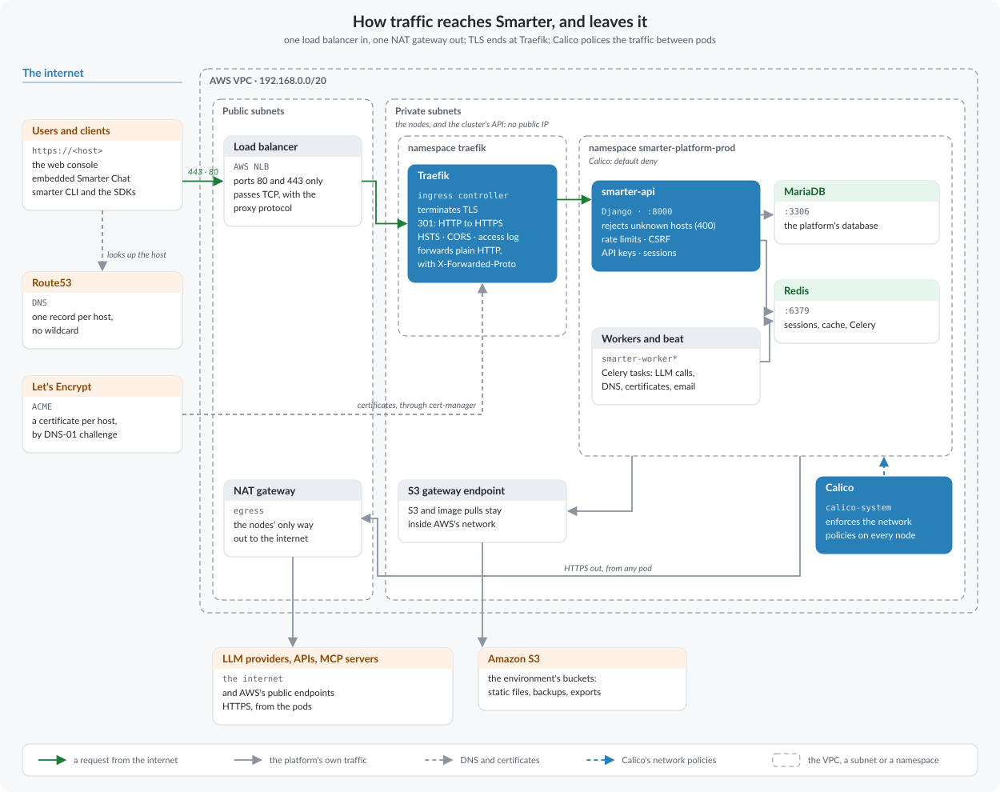
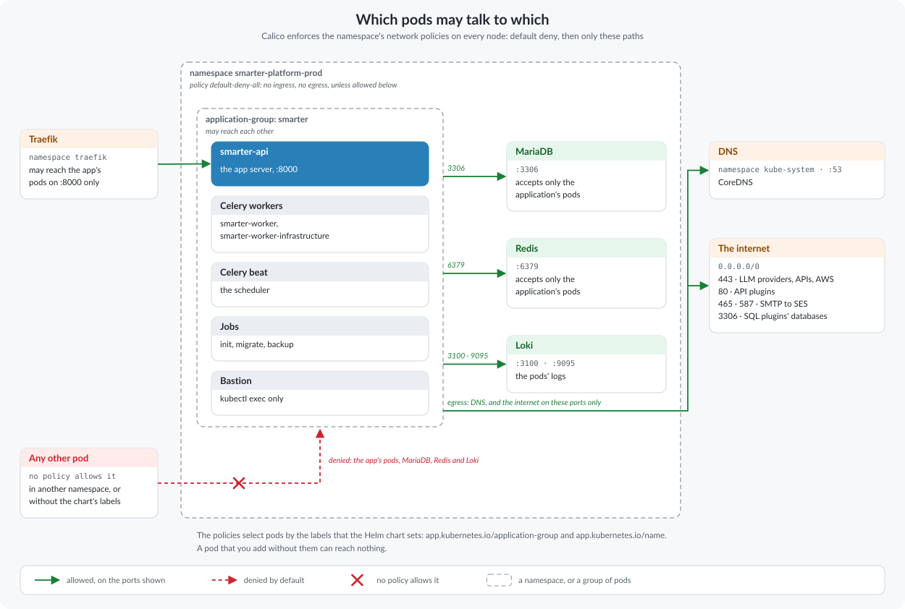
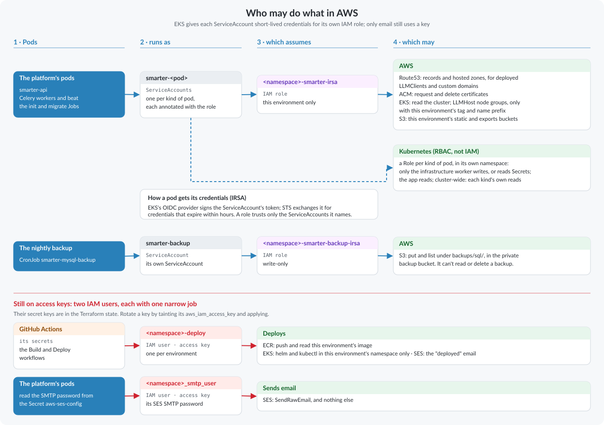

Infrastructure Security
=======================

How the cloud infrastructure that
`smarter-infrastructure <https://github.com/smarter-sh/smarter-infrastructure>`__ builds with
Terraform on AWS controls who and what can reach the cluster, its pods and its data: the network,
identities and permissions, and the containers. It describes a platform installed as
:doc:`../../installation/production-deployment` describes.

Network
-------

         wildcard, and connect to one Network Load Balancer in the VPC's public subnets, on ports 80 and 443 only.
         It passes TCP to Traefik in the private subnets, which terminates TLS with a certificate from Let's
         Encrypt, redirects HTTP to HTTPS, sets HSTS and CORS, and forwards plain HTTP to smarter-api on port 8000.
         Calico, on every node, enforces the platform namespace's network policies, so only the platform's pods
         reach MariaDB and Redis. The pods leave through a NAT gateway, to LLM providers
         and APIs, and reach S3 through a gateway endpoint.
   :width: 100%

The VPC
~~~~~~~

smarter-infrastructure creates the VPC, ``192.168.0.0/20``, with public, private, database and intra
subnets in each availability zone. The EKS control plane and every node are in the **private
subnets**, with no public IP address, and reach the internet through a NAT gateway. Only the load
balancer is in the public subnets. An S3 gateway endpoint keeps the pods' S3 traffic, including
image pulls, inside AWS's network.

The cluster's API endpoint is reachable both from inside the VPC and publicly, authenticated by
AWS IAM. Restrict its public access to your own addresses (``endpoint_public_access_cidrs`` of the
EKS module) if your policies require it.

Ingress: one load balancer, Traefik and TLS
~~~~~~~~~~~~~~~~~~~~~~~~~~~~~~~~~~~~~~~~~~~

Every request from the internet arrives through one AWS **Network Load Balancer**, on ports 80 and
443 only, and goes to the **Traefik** ingress controller, in its own ``traefik`` namespace:

- **TLS terminates at Traefik**, with a certificate per host that cert-manager obtains from Let's
  Encrypt, by DNS-01 challenge against Route53. Traefik forwards the request to the app as plain
  HTTP inside the cluster, with ``X-Forwarded-Proto``. Traefik trusts the forwarded and proxy
  protocol headers only from the VPC's addresses, so a client can't forge them.
- **HTTP is redirected to HTTPS** (301), and **HSTS** is set, by Traefik middlewares, for every host
  in one place, deployed LLMClients and custom domains included. ``includeSubDomains`` and
  ``preload`` stay off, because deployed LLMClients live under the platform's domains.
- **CORS** headers are set by a Traefik middleware for the platform's and the API's domains, and by
  Smarter's own middleware (see :doc:`application`).
- **No wildcard DNS.** Each deployed LLMClient gets its own DNS record in a Route53 hosted zone, its
  own Ingress that answers only for its own host name, and its own certificate. A request for an
  undefined subdomain reaches nothing, which prevents subdomain takeover.

.. raw:: html

   

Node security groups
~~~~~~~~~~~~~~~~~~~~

With ``enable_enhanced_security`` (on, in smarter-infrastructure's ``aws/stack/stack.hcl``), the
nodes' security group replaces the EKS module's recommended rules with a narrower set:

- **Ingress:** traffic from inside the VPC (the load balancer, the control plane's kubelet calls on
  10250, DNS), the NodePort range from the load balancer, and ICMP "fragmentation needed", for path
  MTU discovery.
- **Egress:** node-to-node traffic, HTTP and HTTPS, DNS, NTP, SMTP (25 and 587), and replies on
  ephemeral ports.

There is no SSH access to the nodes. Administrators reach the cluster with ``kubectl``, authenticated
by IAM, and reach a shell with the bastion pod (below).

Pod network policies: Calico
~~~~~~~~~~~~~~~~~~~~~~~~~~~~

Security groups apply to whole nodes. To control traffic between **pods**, smarter-infrastructure
installs `Calico <https://docs.tigera.io/calico/latest/about/>`__ (the Tigera operator) in
**policy-only mode**: the AWS VPC CNI still gives every pod its VPC address, and Calico's agent on
each node enforces Kubernetes NetworkPolicies with iptables rules. It then creates these policies in
the platform's namespace:

- **Default deny,** for ingress and egress, for every pod in the namespace. Traffic flows only where
  a policy below allows it.
- **Ingress to the application's pods** (the app, the Celery workers, beat, the init Job and the
  bastion) from pods in the same namespace, and from the Traefik namespace on the app's port only.
- **MariaDB** accepts connections on 3306, and **Redis** on 6379, only from the application's pods.
- **Egress from the application's pods** only to MariaDB, Redis and Loki in the namespace, DNS in
  ``kube-system``, and to the internet on HTTPS (443), HTTP (80, for API plugins), SMTP (465, 587)
  and MySQL (3306, for SQL plugins' remote databases).
- **The bastion pod** may also reach the internet on 80 and 443, for package updates.

         on port 8000 only. The application's pods (smarter-api, the Celery workers, beat, the Jobs and the bastion)
         may reach each other, MariaDB on 3306, Redis on 6379, Loki on 3100 and 9095, DNS in kube-system, and the
         internet on 443, 80, 465, 587 and 3306. A pod in another namespace, or without the chart's labels, can
         reach nothing.
   :width: 100%

The policies select pods by their labels, ``app.kubernetes.io/application-group`` and
``app.kubernetes.io/name``, which the Helm chart sets. A pod without them can't talk to anything,
so keep them on any pod that you add. The policies are created for the namespace named in
smarter-infrastructure's ``stack.hcl`` (the ``prod`` environment's); add the same policies to any
other environment's namespace that needs them.

Because the application's pods may reach any address on port 443, the policies limit movement inside
the cluster, but they don't stop code from sending data out over HTTPS. See
:doc:`supply-chain`.

Identity and Access
-------------------

AWS: roles, not access keys
~~~~~~~~~~~~~~~~~~~~~~~~~~~

         <namespace>-smarter-irsa: Route53, ACM, reading the cluster, LLMHost node groups with the environment's
         tag, and the environment's S3 buckets. Kubernetes permissions come from RBAC: a Role in the namespace and
         read-only cluster-wide access. The nightly backup runs as smarter-backup, whose role may only write to
         backups/sql/. Two IAM users still have access keys: the deploy user, which GitHub Actions uses to push the
         image and run helm in the namespace, and the SMTP user, whose SES SMTP password the pods use to send email.
   :width: 100%

The platform's pods call AWS's APIs with **no access keys**. They get short-lived credentials from IAM roles,
with `IAM Roles for Service Accounts <https://docs.aws.amazon.com/eks/latest/userguide/iam-roles-for-service-accounts.html>`__
(IRSA): the chart annotates each ServiceAccount with its role, and EKS hands its pods credentials for
that role only. Each environment has its own roles, so ``alpha`` can't touch ``prod``'s buckets or
node groups.

- ``<namespace>-smarter-irsa``, the ServiceAccount ``smarter`` (the app, the workers, beat and the
  init Job): Route53 and ACM for deployed LLMClients' and custom domains' DNS and certificates; read
  access to the cluster's status; LLMHost node groups, which it may create only with the
  environment's tag and change only by the environment's name prefix; and read and write access to
  the environment's own S3 buckets.
- ``<namespace>-smarter-backup-irsa``, the ServiceAccount ``smarter-backup`` (the nightly backup):
  write-only access to ``backups/sql/`` in the backup bucket. It can't read or delete a backup, so a
  compromised backup pod can't destroy earlier ones.
- The cluster's own components (the VPC CNI, the EBS CSI driver, cert-manager, the cluster autoscaler)
  each have their own IRSA role too.

Two IAM users with access keys remain, each with one narrow job: the environment's **deploy user**,
whose key the GitHub Actions Deploy workflow uses to push the image to ECR and run ``helm`` in that
environment's namespace only, and the **SMTP user**, which may only send email through SES. The pods
send the platform's email with the SMTP user's SES SMTP password, which smarter-infrastructure puts in
the Kubernetes Secret ``aws-ses-config``; it is the one AWS credential that the pods hold. Both
users' secret keys are in the Terraform state. Rotate them by tainting the access key resource and applying.

Kubernetes RBAC
~~~~~~~~~~~~~~~

The ServiceAccount ``smarter`` has a **Role in its own namespace** (the chart's ``rbac.yaml``), to
manage the resources of deployed LLMClients: Deployments, Services, Ingresses, Secrets and
certificates. Its only cluster-wide permissions are reads: its own namespace, nodes,
PersistentVolumes and node metrics, in a ClusterRole that smarter-infrastructure creates
(``serviceAccount.createClusterRole: false`` in the chart's values). The deploy user's EKS access
entry is also limited to the environment's namespace.

Pods and Containers
-------------------

- **Non-root, read-only.** Every pod that runs the Smarter image runs as ``smarter_user`` (uid 1000),
  with ``runAsNonRoot``, a read-only root filesystem, every Linux capability dropped, no privilege
  escalation, and the ``RuntimeDefault`` seccomp profile. The few directories that the processes
  write are ``emptyDir`` volumes.
- **Settings in a Secret.** The chart stores the pods' environment, API keys and passwords included,
  in a Kubernetes Secret that every pod reads with ``envFrom``, so they aren't written into pod
  specs. The database, administrator and Django credentials come from Secrets that
  smarter-infrastructure generates in the namespace.
- **Images.** Each environment's ECR repository scans every pushed image for vulnerabilities. The
  cluster pulls third-party images through an ECR pull-through cache. Each release's Smarter image
  and Helm chart are signed with Cosign, and the image carries a software bill of materials. See
  "Verifying a release" in :doc:`supply-chain`.
- **The bastion pod** is the one place for a shell with the platform's environment, reached with
  ``kubectl exec``, which needs the cluster's IAM credentials.
- **The web console's Terminal**, a shell inside the app's container for superusers, is off by
  default. Leave ``SMARTER_APP_DASHBOARD_WEB_CONSOLE_TERMINAL_ENABLE`` unset in production unless
  you need it: the shell runs with the server's credentials.

What Smarter Doesn't Provide
----------------------------

Smarter and smarter-infrastructure don't set up the following. Add them with your own AWS account's
tools if your policies require them:

- **A web application firewall** (AWS WAF, or Shield Advanced). The Network Load Balancer passes TCP;
  Traefik's middlewares and Smarter's rate limits are the application's only filters.
- **Threat detection and account auditing:** GuardDuty, CloudTrail, Security Hub.
- **Malware scanning** of uploaded files.
- **Encryption at rest with your own KMS keys**, for Kubernetes Secrets and the database's volume
  (see Data Protection, in :doc:`application`).
