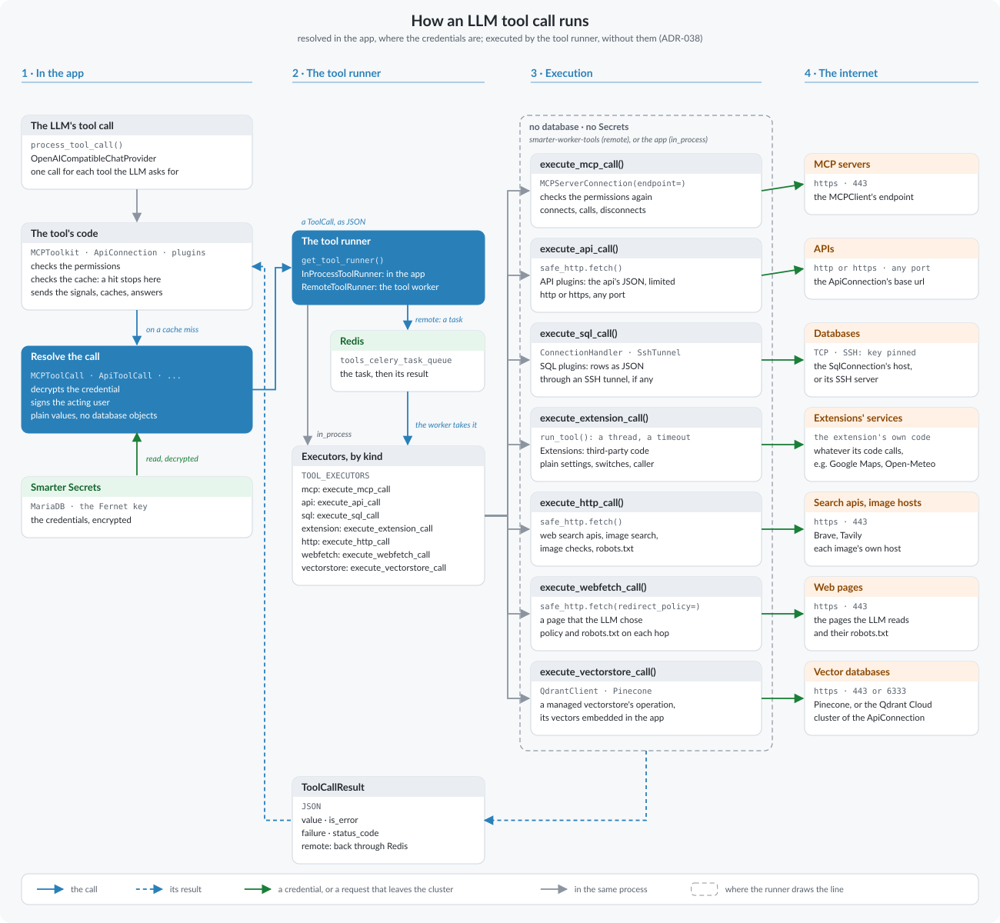

Tool Runner
===========

         miss it resolves the call, decrypting the credential from its Smarter Secret, into a ToolCall of plain values.
         The tool runner, from get_tool_runner(), finds the executor of the call's kind in TOOL_EXECUTORS:
         execute_mcp_call for MCP clients, execute_api_call for API plugins, execute_sql_call for SQL plugins,
         through an SSH tunnel when the connection uses one, execute_extension_call for Extensions, whose code gets
         its settings, switches and caller as plain values, execute_http_call for the web search
         apis, the Brave image search, the checks of each image's url and websites' robots.txt, and
         execute_webfetch_call for the pages that the web search plugin reads, with its domain policy and robots.txt
         checked again on each redirect. The executor reads neither the app's database nor a Secret, and calls the MCP
         server, the api, the SqlConnection's database, the search api or the website. Its ToolCallResult returns to the tool's code in the app, which
         sends the signals, caches the result and gives it to the LLM. The in-process runner executes the call in the
         app's process. The remote runner sends it as JSON through Redis to the tool worker, smarter-worker-tools, which
         has no database, no Secret and no cloud credential, runs the same executor there, and returns the result
         through Redis.
   :width: 100%

Every LLM tool call is resolved in the app into a serializable call, with the credentials it needs,
and executed by the tool runner: in the app's own process, or in the tool worker, a Celery worker
that holds no credential of the platform's (:doc:`ADR-038 </adr/038-tool-isolation-and-egress>`).

The tool's own code stays in the app, around the runner: it checks the permissions and the cache,
resolves the call only when the cache misses, so that a credential is read only for a call that
runs, and, from the result, sends the signals, stores the result in the cache and answers the LLM.
The executor of each kind of call, registered in ``TOOL_EXECUTORS``, reads no database and no
Smarter Secret. These go through it:

- MCP clients, with :mod:`smarter.apps.mcpclient.execution`;
- API plugins, with :mod:`smarter.apps.connection.execution`;
- SQL plugins, with :mod:`smarter.apps.connection.execution`, through an SSH tunnel
  (:mod:`smarter.apps.connection.ssh`) for a connection that uses one;
- Extensions, with :mod:`smarter.apps.llmtool.extension.execution`. Their code is a third party's, so
  its context holds plain values decided before the call: its settings, its switches, and who called
  it, as an ``ExtensionCaller``. The executor loads an Extension's code, its archive, by its sha256,
  from the cache, where the app publishes it for the remote runner, or else from the database, the
  first time a process runs a version;
- the WebsearchPlugin's search apis (Brave, Tavily), the ImageSearchPlugin's Brave image search and
  its checks of each image's url, and every website's robots.txt, with
  :mod:`smarter.apps.llmtool.runner.http`. Its ``fetch_with_runner()`` takes the place of
  ``safe_http.fetch()``, so each of them changed by one line;
- the WebsearchPlugin's fetch of a page, with ``WebFetchToolCall`` and ``execute_webfetch_call()`` in
  :mod:`smarter.apps.llmtool.plugin.websearch_fetch`. ``fetch``'s ``redirect_policy`` is a function,
  which can't travel with a call, so the call carries what it decides on, the domain policy and
  whether to obey robots.txt, and the executor builds the function where the call runs.

Choosing the runner
-------------------

``SMARTER_APP_LLMTOOL_TOOL_RUNNER`` chooses the runner that :func:`~smarter.apps.llmtool.runner.runner.get_tool_runner`
returns:

``in_process``, the default
    :class:`~smarter.apps.llmtool.runner.runner.InProcessToolRunner` executes each call in the
    process that resolved it: the app, or the Celery worker that runs an orchestration.

``remote``
    :class:`~smarter.apps.llmtool.runner.runner.RemoteToolRunner` sends each call, as JSON, in the Celery
    task ``run_tool_call`` (:mod:`smarter.apps.llmtool.tasks`), on the queue
    ``SMARTER_APP_TOOLS_TASKS_CELERY_TASK_QUEUE`` (``tools_celery_task_queue``), and waits for its result
    in the result backend, the broker's Redis. The tool worker rebuilds the call with its kind's model,
    registered in ``TOOL_CALL_MODELS``, runs it in process, and returns its result. The app waits four
    times the call's timeout, plus 15 seconds, and at most 10 minutes; a worker that doesn't answer in
    that time, or a task that fails, is a ``failure`` for the LLM, as any call that couldn't be made is.

The tool worker, ``smarter-worker-tools``, runs with ``SMARTER_DATABASE_UNAVAILABLE=true``: it never opens
a database connection, reads every waffle switch as off, and starts without the Django secret key. It
takes nothing from the platform but the broker's and the cache's url: each call brings what it needs.
It runs without task events (no ``-E``), which would copy each call's arguments, and its credentials,
to Celery's events stream. ``make run`` starts one, which takes calls only when the app's
``SMARTER_APP_LLMTOOL_TOOL_RUNNER`` is ``remote``. On Kubernetes, the Helm chart's ``workerTools.enabled``
deploys it and makes the app's runner remote: see :doc:`/smarter-framework/smarter-on-kubernetes/tool-worker`.

.. automodule:: smarter.apps.llmtool.runner.http
    :members:
    :undoc-members:
    :show-inheritance:

.. automodule:: smarter.apps.llmtool.runner.models
    :members:
    :undoc-members:
    :show-inheritance:

.. automodule:: smarter.apps.llmtool.runner.runner
    :members:
    :undoc-members:
    :show-inheritance:
